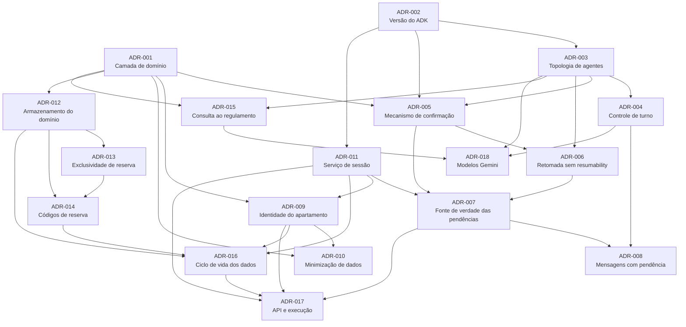

# Architectural Decision Records — Assistente Virtual do Residencial Aurora

> **Base:** [`docs/PRD.md`](../PRD.md) · [`docs/SUMMARY.md`](../SUMMARY.md) · [`ENUNCIADO.md`](../../ENUNCIADO.md)
> **Template:** [`docs/templates/ADR.md`](../templates/ADR.md)
> **Data:** 2026-10-30 · **Versão de referência do ADK:** 2.13.0 (comportamentos verificados no código-fonte do pacote)

Cada ADR trata de **uma única decisão**. As dependências entre decisões aparecem no campo **Relacionados** de cada documento, separadas em *Depende de*, *Influencia* e *Interage com*, e estão resumidas no grafo abaixo.

Todos os ADRs estão como **Proposto**. Os marcados com 🧪 dependem da [prova de conceito](#provas-de-conceito-que-podem-reverter-decisões) para passar a **Aceito**.

---

## Índice

| ADR | Decisão | Garantias | Status |
| :--- | :--- | :--- | :--- |
| [ADR-001](ADR-001-regras-em-camada-de-dominio.md) | Regras críticas numa camada de domínio determinística; tools como adaptadores finos | G1, G2, G5 | Proposto |
| [ADR-002](ADR-002-versao-do-google-adk.md) | Fixar `google-adk[db]==2.13.0` (contingência: 2.9.1, depois 2.2.0) | Todas | Proposto 🧪 |
| [ADR-003](ADR-003-topologia-de-agentes.md) | `concierge` + `reservas` e `visitantes` (`chat`, por transferência) + `regulamento` (`AgentTool`) | G1, G4 | Proposto 🧪 |
| [ADR-004](ADR-004-controle-de-turno-e-transferencias.md) | Especialistas sem transferência para o pai nem para os pares: todo turno começa no `concierge` | G1 | Proposto 🧪 |
| [ADR-005](ADR-005-mecanismo-de-confirmacao.md) | Confirmação nativa com `require_confirmation` declarativo (predicado de taxa *fail-closed*; visitante sempre) | G1 | Proposto 🧪 |
| [ADR-006](ADR-006-retomada-sem-resumability.md) | `App` sem `ResumabilityConfig`; cada resposta de confirmação abre uma nova invocação | G1 | Proposto 🧪 |
| [ADR-007](ADR-007-fonte-de-verdade-das-confirmacoes.md) | Pendências e `409` derivados dos eventos persistidos, sem tabela própria | G1, G3 | Proposto |
| [ADR-008](ADR-008-mensagens-com-confirmacao-pendente.md) | Nova mensagem com pendência aberta é processada; a pendência continua válida | G1 | Proposto 🧪 |
| [ADR-009](ADR-009-identidade-do-apartamento.md) | `user_id` do ADK = apartamento; tools leem `tool_context.user_id`; índice `session_id` → apartamento | G2 | Proposto |
| [ADR-010](ADR-010-minimizacao-de-dados-nas-tools.md) | Saídas tipadas e mínimas; disponibilidade binária; erros indistinguíveis e sem dados de terceiros | G2 | Proposto |
| [ADR-011](ADR-011-servico-de-sessao-persistente.md) | `DatabaseSessionService` sobre SQLite próprio, com WAL e `busy_timeout` | G3 | Proposto 🧪 |
| [ADR-012](ADR-012-armazenamento-do-dominio.md) | Domínio em SQLite separado, via SQLAlchemy async | G3, G5 | Proposto |
| [ADR-013](ADR-013-exclusividade-de-reserva.md) | Índice único parcial `(area_id, data) WHERE status='ativa'`; conflito vira resposta de negócio | G5 | Proposto |
| [ADR-014](ADR-014-codigos-de-reserva.md) | Códigos `RSV-XXXXXX` aleatórios + registro permanente de códigos emitidos | RN-05 | Proposto |
| [ADR-015](ADR-015-consulta-ao-regulamento.md) | Regulamento indexado por capítulo; tool com identificador fechado; execução isolada | G4 | Proposto |
| [ADR-016](ADR-016-ciclo-de-vida-dos-dados.md) | Esquema idempotente na subida; seed por marcador; restauração limpa as sessões | G3 | Proposto |
| [ADR-017](ADR-017-api-e-modelo-de-execucao.md) | FastAPI, processo único, `Runner` compartilhado, lock por sessão, mapeamento de erros | Contrato | Proposto |
| [ADR-018](ADR-018-modelos-gemini.md) | Um modelo Flash estável para todos os agentes, via `AURORA_MODELO` | — | Proposto |

---

## Grafo de dependências

Uma seta `A --> B` significa "B depende de A".

### Blocos de decisão

| Bloco | ADRs | Observação |
| :--- | :--- | :--- |
| **Orquestração e confirmação** (G1) | 002 → 003 → 004 → 005 → 006 → 007 → 008 | Cadeia mais sensível. Uma falha na prova de conceito pode forçar revisão em cascata |
| **Identidade e privacidade** (G2) | 009 → 010 | Independente da topologia; depende só do domínio e do serviço de sessão |
| **Persistência e concorrência** (G3, G5) | 011, 012 → 013 → 014 → 016 | Decisões de armazenamento; a 013 é a garantia de G5 |
| **Regulamento** (G4) | 003 → 015 | O isolamento depende do `AgentTool` escolhido no ADR-003 |
| **Borda e operação** | 016 → 017, 018 | Contrato, comandos e modelo |

---

## Provas de conceito que podem reverter decisões

Executar **antes** de implementar o restante. Elas validam a cadeia mais arriscada (GT-01).

| # | Experimento | Valida | Se falhar |
| :--- | :--- | :--- | :--- |
| PoC-1 | Reservar o salão numa sessão SQLite, aprovar pela API e conferir a reserva no banco | ADR-003, 004, 005, 006, 011 | Testar a topologia `single_turn` (contingência do ADR-003); depois ADK 2.9.1 (ADR-002); por último, pendência própria (A2 do ADR-005) |
| PoC-2 | Repetir a PoC-1 com reinício da API entre o pedido e a aprovação | ADR-006, 007, 011 | Revisar o ADR-006 (habilitar a retomada com chaves de idempotência) |
| PoC-3 | Reenviar o mesmo `id` aprovado e enviar um `id` inexistente | ADR-007 | Revisar o cálculo de pendências |
| PoC-4 | Criar uma pendência, enviar uma mensagem intermediária e aprovar depois | ADR-008 | Adotar A2 do ADR-008 (negar automaticamente antes de nova mensagem) |
| PoC-5 | Duas aprovações simultâneas (`curl ... & curl ...`) para a mesma área e data | ADR-011, 012, 013, 017 | Ajustar `busy_timeout` e transações; em último caso, PostgreSQL (A1 dos ADRs 011 e 012) |
| PoC-6 | Perguntar sobre a piscina e varrer `GET /eventos` em busca de outros capítulos | ADR-003, 015 | Revisar a seleção de capítulo e as instruções do especialista |

---

## Decisões do SUMMARY e onde foram endereçadas

| Decisão em aberto ([SUMMARY §14](../SUMMARY.md#14-decisões-em-aberto-para-o-plano)) | ADR |
| :--- | :--- |
| D-01 Versão do ADK | [ADR-002](ADR-002-versao-do-google-adk.md) |
| D-02 Topologia e acionamento | [ADR-003](ADR-003-topologia-de-agentes.md), [ADR-004](ADR-004-controle-de-turno-e-transferencias.md) |
| D-03 Quais especialistas | [ADR-003](ADR-003-topologia-de-agentes.md) |
| D-04 Modelo por agente | [ADR-018](ADR-018-modelos-gemini.md) |
| D-05 Mecanismo de confirmação | [ADR-005](ADR-005-mecanismo-de-confirmacao.md), [ADR-006](ADR-006-retomada-sem-resumability.md) |
| D-06 Origem das pendências e `409` | [ADR-007](ADR-007-fonte-de-verdade-das-confirmacoes.md) |
| D-07 Serviço de sessão | [ADR-011](ADR-011-servico-de-sessao-persistente.md) |
| D-08 Armazenamento do domínio | [ADR-012](ADR-012-armazenamento-do-dominio.md) |
| D-09 Restrição de exclusividade | [ADR-013](ADR-013-exclusividade-de-reserva.md) |
| D-10 Gerador de código | [ADR-014](ADR-014-codigos-de-reserva.md) |
| D-11 Consulta ao regulamento | [ADR-015](ADR-015-consulta-ao-regulamento.md) |
| D-12 `session_id` → `user_id` | [ADR-009](ADR-009-identidade-do-apartamento.md) |
| D-13 Restauração apaga sessões? | [ADR-016](ADR-016-ciclo-de-vida-dos-dados.md) |
| D-14 Mensagem com pendência aberta | [ADR-008](ADR-008-mensagens-com-confirmacao-pendente.md) |
| D-15 Framework web | [ADR-017](ADR-017-api-e-modelo-de-execucao.md) |
| — Regras no código, não no prompt (PRD) | [ADR-001](ADR-001-regras-em-camada-de-dominio.md) |
| — Minimização de dados (PRD) | [ADR-010](ADR-010-minimizacao-de-dados-nas-tools.md) |
