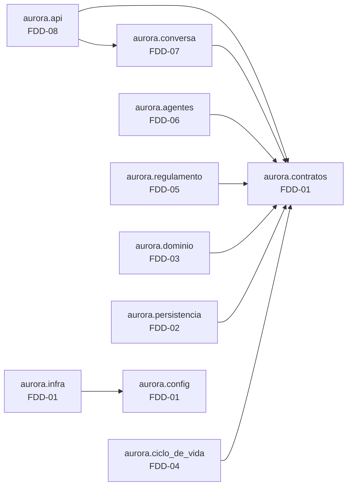

# Feature Design Document (FDD): Fundação do projeto e contratos compartilhados

---
**Versão:** v1.0  
**Data:** 2026-10-30  
**Responsável:** Lucas Rocha  
**Status:** Rascunho  
**ADRs implementados:** [ADR-001](../adr/ADR-001-regras-em-camada-de-dominio.md), [ADR-002](../adr/ADR-002-versao-do-google-adk.md), [ADR-018](../adr/ADR-018-modelos-gemini.md) (parte: configuração e fábrica de modelo)  
**Depende de:** nenhuma feature (é a **onda 0**)  
**Bloqueia:** todas as demais features (FDD-02 a FDD-09)  
---

## 1. Contexto e motivação técnica

O repositório não tem código. As oito features seguintes ([índice](README.md)) precisam ser desenvolvidas **em paralelo**, e isso só é possível se três coisas forem definidas antes de qualquer implementação:

1. **Estrutura de diretórios e dono de cada arquivo**, para que nenhuma feature edite arquivos de outra.
2. **Contratos entre camadas** (`Protocol`s e DTOs imutáveis). Assim, cada feature programa contra uma interface, e não contra a implementação de outra (*Separation of Concerns* e *Dependency Injection*, da skill `python-design-patterns`).
3. **Implementações falsas em memória** desses contratos, para que cada feature teste sua camada isolada, sem banco, sem ADK e sem modelo.

Este FDD também concentra o que é transversal e pequeno demais para virar feature própria:

- empacotamento com `uv` e a versão fixada do ADK ([ADR-002](../adr/ADR-002-versao-do-google-adk.md));
- leitura de configuração e do `.env`;
- a fábrica de engine SQLite com WAL e `busy_timeout`, usada pelo domínio e pelas sessões ([ADR-011](../adr/ADR-011-servico-de-sessao-persistente.md), [ADR-012](../adr/ADR-012-armazenamento-do-dominio.md));
- a fábrica do modelo Gemini ([ADR-018](../adr/ADR-018-modelos-gemini.md)).

---

## 2. Objetivos técnicos

* Entregar um projeto instalável com `uv sync`, com `google-adk[db]==2.13.0` fixado e `uv.lock` versionado.
* Definir **todos os contratos entre features** em `aurora.contratos`, com `__all__` explícito.
* Fornecer **fakes em memória** de todos os `Protocol`s, prontos para os testes das outras features.
* Centralizar a configuração (variáveis de ambiente e caminhos) num objeto imutável, injetado por construtor.
* Oferecer as fábricas compartilhadas `criar_engine_sqlite(...)` e `criar_modelo(...)`.

---

## 3. Escopo e exclusões

### Incluído
* `pyproject.toml` (Python ≥ 3.12, dependências, `[project.scripts]` reservados para `aurora-api` e `aurora-restaurar`), `uv.lock` e `.python-version`.
* `.gitignore` com `var/`, `.env` e `.tmp/`; `.env.example` com os nomes das variáveis.
* Layout `src/aurora/` e esqueleto de todos os pacotes (com `__init__.py` e `__all__`), conforme a tabela de propriedade do [índice](README.md#estrutura-do-código-e-propriedade-dos-arquivos).
* `aurora.config`: `Configuracoes` e `carregar_configuracoes()`.
* `aurora.contratos`: DTOs de domínio, tipos de resultado, `Protocol`s de repositórios, de serviços e da conversa, exceções de aplicação e o vocabulário de ações.
* `aurora.infra`: `criar_engine_sqlite()`, `criar_modelo()` e `configurar_logs()`.
* `tests/fakes/`: implementações em memória dos `Protocol`s.
* Ferramentas de qualidade: `ruff` (lint e formatação) e `pytest` com `pytest-asyncio`, como dependências de desenvolvimento.

### Excluído
* Qualquer regra de negócio (FDD-03), SQL (FDD-02), agente (FDD-05 e FDD-06) ou rota HTTP (FDD-08).
* A escolha final do identificador do modelo Gemini. Aqui fica só o mecanismo; o valor é definido na implementação do FDD-06, conforme o [ADR-018](../adr/ADR-018-modelos-gemini.md).

---

## 4. Fluxos detalhados e diagramas

* **Fluxo A: direção das dependências entre camadas.** A seta indica "importa de".



  As setas mostram só os imports do código de cada feature. Imports entre features (ex.: o FDD-08 usando a implementação do FDD-07) acontecem **apenas no módulo de montagem** (`aurora.api.montagem`, FDD-08).

  Regra: **nenhum módulo importa de uma camada "acima"**. `aurora.contratos` não importa nada do projeto, nem `google.adk`.

* **Fluxo B: carga de configuração.**
  1. `carregar_configuracoes()` lê o `.env` com `python-dotenv` (sem sobrescrever variáveis já definidas).
  2. Monta `Configuracoes`, com caminhos absolutos resolvidos a partir da raiz do projeto.
  3. Valida as variáveis obrigatórias (`GOOGLE_API_KEY`) e falha cedo com mensagem clara.
  4. O objeto é injetado nos construtores. Nenhum módulo lê `os.environ` diretamente.

* **Fluxo C: engine SQLite.** `criar_engine_sqlite(caminho)` cria o diretório pai e um `AsyncEngine` `sqlite+aiosqlite`. Num *listener* `connect`, ele executa:
  - `PRAGMA journal_mode=WAL`;
  - `PRAGMA busy_timeout=<ms>`;
  - `PRAGMA foreign_keys=ON`.

---

## 5. Contratos públicos (assinaturas, headers, exemplos)

### 5.1 Interface pública

```python
# src/aurora/config.py
@dataclass(frozen=True, slots=True)
class Configuracoes:
    raiz_projeto: Path
    diretorio_dados: Path            # <raiz>/dados (somente leitura)
    banco_dominio: Path              # <raiz>/var/aurora.db
    banco_sessoes: Path              # <raiz>/var/sessions.db
    nome_app: str                    # "residencial_aurora"
    modelo: str                      # AURORA_MODELO (padrão definido no código)
    temperatura: float               # 0.1
    sqlite_busy_timeout_ms: int      # 5000
    host: str                        # "127.0.0.1"
    porta: int                       # 8000

def carregar_configuracoes(raiz: Path | None = None, *, exigir_chave: bool = True) -> Configuracoes: ...
    # exigir_chave=False é usado pelo comando de restauração (FDD-04), que não chama o modelo
```

```python
# src/aurora/contratos/modelos.py — DTOs imutáveis; nenhum carrega dado de outro apartamento
@dataclass(frozen=True, slots=True)
class Area: id: str; nome: str; taxa: Decimal
@dataclass(frozen=True, slots=True)
class Apartamento: numero: str; morador: str
@dataclass(frozen=True, slots=True)
class Reserva: codigo: str; apartamento: str; area_id: str; data: date
@dataclass(frozen=True, slots=True)
class Visitante: apartamento: str; nome: str; data: date

# Resultados de operação: o conjunto fechado do que pode sair do domínio (ADR-010)
class MotivoInvalido(StrEnum):
    AREA_INEXISTENTE = "area_inexistente"
    DATA_INVALIDA = "data_invalida"
    NOME_INVALIDO = "nome_invalido"
    IDENTIFICACAO_INCOMPLETA = "identificacao_incompleta"   # cancelar sem código nem área+data

@dataclass(frozen=True, slots=True)
class EntradaInvalida: motivo: MotivoInvalido
@dataclass(frozen=True, slots=True)
class Disponibilidade: area_id: str; data: date; disponivel: bool
@dataclass(frozen=True, slots=True)
class ReservaCriada: codigo: str; area_id: str; data: date
@dataclass(frozen=True, slots=True)
class ReservaCancelada: codigo: str; area_id: str; data: date
@dataclass(frozen=True, slots=True)
class Indisponivel: area_id: str; data: date              # nunca contém dono nem código
@dataclass(frozen=True, slots=True)
class NaoEncontrada: ...                                   # indistinguível: inexistente ou de terceiro
@dataclass(frozen=True, slots=True)
class VisitanteAutorizado: nome: str; data: date

ResultadoConsulta = Disponibilidade | EntradaInvalida
ResultadoReserva = ReservaCriada | Indisponivel | EntradaInvalida
ResultadoCancelamento = ReservaCancelada | NaoEncontrada | EntradaInvalida
ResultadoVisitante = VisitanteAutorizado | EntradaInvalida

@dataclass(frozen=True, slots=True)
class DadosIniciais:
    apartamentos: tuple[Apartamento, ...]
    areas: tuple[Area, ...]
    reservas: tuple[Reserva, ...]
    visitantes: tuple[Visitante, ...]
```

```python
# src/aurora/contratos/repositorios.py — implementados pelo FDD-02
class RepositorioReservas(Protocol):
    async def criar(self, *, apartamento: str, area_id: str, data: date,
                    gerar_codigo: Callable[[], str]) -> ReservaCriada | Indisponivel: ...
    async def cancelar_ativa(self, *, apartamento: str, area_id: str, data: date) -> ReservaCancelada | NaoEncontrada: ...
    async def cancelar_por_codigo(self, *, apartamento: str, codigo: str) -> ReservaCancelada | NaoEncontrada: ...
    async def listar_ativas(self, apartamento: str) -> list[Reserva]: ...
    async def esta_ocupada(self, *, area_id: str, data: date) -> bool: ...

class RepositorioVisitantes(Protocol):
    async def autorizar(self, *, apartamento: str, nome: str, data: date) -> Visitante: ...
    async def listar(self, apartamento: str) -> list[Visitante]: ...

class CatalogoReferencia(Protocol):
    async def listar_areas(self) -> list[Area]: ...
    async def apartamento_existe(self, numero: str) -> bool: ...

class IndiceSessoes(Protocol):
    async def registrar(self, *, session_id: str, apartamento: str) -> None: ...
    async def apartamento_de(self, session_id: str) -> str | None: ...
    async def remover(self, session_id: str) -> None: ...
    async def limpar(self) -> None: ...

class RepositorioCargaInicial(Protocol):
    async def criar_esquema(self) -> None: ...                       # idempotente
    async def seed_aplicado(self) -> bool: ...
    async def restaurar(self, dados: DadosIniciais) -> None: ...     # transação única (ADR-016)
```

```python
# src/aurora/contratos/servicos.py — implementados pelo FDD-03; consumidos por FDD-06 e FDD-08
class ServicoReservas(Protocol):
    def listar_areas(self) -> list[Area]: ...
    def resolver_area(self, area: str) -> Area | None: ...           # normalização usada também pelo DescritorAcoes (FDD-06)
    def exige_confirmacao(self, area: str) -> bool: ...              # síncrono e fail-closed (ADR-005)
    async def consultar_disponibilidade(self, *, area: str, data: str) -> ResultadoConsulta: ...
    async def reservar(self, *, apartamento: str, area: str, data: str) -> ResultadoReserva: ...
    async def cancelar(self, *, apartamento: str, area: str | None = None,
                       data: str | None = None, codigo: str | None = None) -> ResultadoCancelamento: ...
    async def listar_do_apartamento(self, apartamento: str) -> list[Reserva]: ...

class ServicoVisitantes(Protocol):
    async def autorizar(self, *, apartamento: str, nome: str, data: str) -> ResultadoVisitante: ...
    async def listar_do_apartamento(self, apartamento: str) -> list[Visitante]: ...
```

```python
# src/aurora/contratos/conversa.py — implementado pelo FDD-07; consumido pelo FDD-08
ACAO_RESERVAR_AREA = "reservar_area"            # nome da tool = vocabulário de ações (FDD-06 usa, FDD-07 lê)
ACAO_AUTORIZAR_VISITANTE = "autorizar_visitante"

@dataclass(frozen=True, slots=True)
class ConfirmacaoPendente: id: str; acao: str; detalhes: Mapping[str, Any]
@dataclass(frozen=True, slots=True)
class RespostaConversa: resposta: str; confirmacoes_pendentes: tuple[ConfirmacaoPendente, ...]

class ErroAplicacao(Exception): ...
class SessaoNaoEncontrada(ErroAplicacao): ...
class ConfirmacaoNaoPendente(ErroAplicacao): ...
class ApartamentoInvalido(ErroAplicacao): ...
class ModeloIndisponivel(ErroAplicacao): ...

class DescritorAcoes(Protocol):                  # implementado pelo FDD-06; injetado no FDD-07
    def descrever(self, nome_tool: str, argumentos: Mapping[str, Any]) -> tuple[str, dict[str, Any]]: ...

class ServicoConversa(Protocol):
    async def criar_sessao(self, apartamento: str) -> str: ...
    async def enviar_mensagem(self, session_id: str, texto: str) -> RespostaConversa: ...
    async def responder_confirmacao(self, session_id: str, confirmacao_id: str, confirmado: bool) -> RespostaConversa: ...
    async def listar_eventos(self, session_id: str) -> list[dict[str, Any]]: ...
```

```python
# src/aurora/infra/sqlite.py, src/aurora/infra/modelo.py e src/aurora/infra/logs.py
def criar_engine_sqlite(caminho: Path, *, busy_timeout_ms: int) -> AsyncEngine: ...
def criar_modelo(configuracoes: Configuracoes) -> Gemini: ...
    # Gemini(model=configuracoes.modelo, retry_options=types.HttpRetryOptions(attempts=..., initial_delay=...))
def configurar_logs(nivel: str = "INFO") -> None: ...
```

### 5.2 Semântica dos contratos de resposta
* **Tipos de resultado em vez de exceções** para desfechos de negócio (`Indisponivel`, `NaoEncontrada`, `EntradaInvalida`). Exceções ficam reservadas a falhas reais de sistema, o que garante que conflito de negócio nunca vira `500` ([ADR-013](../adr/ADR-013-exclusividade-de-reserva.md)).
* **Os campos dos resultados são a lista exaustiva do que pode chegar ao modelo** ([ADR-010](../adr/ADR-010-minimizacao-de-dados-nas-tools.md)). Acrescentar um campo exige revisar este FDD.
* **Datas** circulam como `datetime.date` dentro do domínio e como `AAAA-MM-DD` nas bordas (tools e API).
* **`ServicoReservas.exige_confirmacao` é síncrono:** as áreas são dado de referência imutável, carregado na montagem, e o ADK aceita predicados síncronos.

### 5.3 Exemplos de uso

```python
# Teste do FDD-03 usando os fakes deste FDD
from tests.fakes import RepositorioReservasEmMemoria, CatalogoReferenciaEmMemoria
from aurora.contratos import Indisponivel

async def test_segunda_reserva_mesma_data_indisponivel(areas):
    servico = ServicoReservasPadrao(reservas=RepositorioReservasEmMemoria(), areas=areas)
    await servico.reservar(apartamento="101", area="quadra", data="2030-04-06")
    resultado = await servico.reservar(apartamento="201", area="quadra", data="2030-04-06")
    assert isinstance(resultado, Indisponivel)
```

---

## 6. Configuração e opções

* **Requisitos de Runtime:** Python 3.12+, `uv` instalado.
* **Armazenamento / Dependências de Infra:** nenhuma infraestrutura externa. Arquivos SQLite em `var/`.
* **Variáveis de ambiente e parâmetros** (nomes no `.env.example`, sem valores):

| Variável | Obrigatória | Uso |
| :--- | :--- | :--- |
| `GOOGLE_API_KEY` | Sim | Chave do Google AI Studio |
| `GOOGLE_GENAI_USE_VERTEXAI` | Não | `FALSE` (documentado no README) |
| `AURORA_MODELO` | Não | Identificador do modelo Gemini; padrão definido no código |

```toml
# pyproject.toml (trecho)
[project]
name = "aurora"
requires-python = ">=3.12"
dependencies = [
  "google-adk[db]==2.13.0",
  "python-dotenv>=1,<2",
]
[project.scripts]
aurora-api = "aurora.api.cli:main"                       # FDD-08
aurora-restaurar = "aurora.ciclo_de_vida.cli:main"       # FDD-04
[dependency-groups]
dev = ["pytest", "pytest-asyncio", "ruff", "httpx"]
```

> As dependências importadas diretamente pelo projeto são declaradas mesmo quando já vêm como dependência transitiva do ADK (`python-dotenv`, e `httpx` para os testes).

---

## 7. Erros, exceções e fallback

### 7.1 Concorrência e atomicidade
* **Por que é crítico:** os dois bancos SQLite recebem escritas concorrentes no passo 14.
* **Garantias:** a fábrica de engine aplica `WAL` e `busy_timeout` em **toda** conexão, e não só na primeira. A atomicidade de cada operação é responsabilidade dos repositórios (FDD-02).

### 7.2 Tratamento de erros gerais
| Situação de Erro | Tratamento Técnico / Comportamento |
| :--- | :--- |
| `GOOGLE_API_KEY` ausente | `carregar_configuracoes()` levanta `ValueError` com mensagem indicando o `.env.example` |
| `AURORA_MODELO` vazio | Usa o padrão do código |
| Diretório `var/` inexistente | Criado por `criar_engine_sqlite()` |

### 7.3 Modo permissivo (Fallback / Fail-Open)
* Não se aplica. A fundação **falha cedo** (fail-fast) quando a configuração está inválida.

---

## 8. Métricas, logs e tracing
* **Métricas:** fora de escopo (sem infraestrutura de métricas no desafio).
* **Logs estruturados:** `aurora.infra.logs.configurar_logs()` configura o `logging` da biblioteca padrão com formato `chave=valor` no stdout, nível `INFO`. Convenção para todas as features: **não logar nomes de visitantes nem texto de mensagens**; logar apenas identificadores (`session_id`, `area_id`, código de reserva do próprio apartamento).
* **Tracing:** o ADK emite spans OpenTelemetry nativamente; nenhum exportador é configurado neste escopo.

---

## 9. Dependências e compatibilidade
| Componente | Versão mínima | Observações |
| :--- | :--- | :--- |
| Python | 3.12 | `.python-version` fixa 3.12 |
| `google-adk[db]` | 2.13.0 (exata) | Traz SQLAlchemy async, aiosqlite, FastAPI, uvicorn e tenacity |
| `python-dotenv` | 1.x | Leitura do `.env` |
| `pytest`, `pytest-asyncio`, `ruff`, `httpx` | — | Grupo `dev` |
| **Features** | — | Nenhuma dependência. Todas as outras dependem deste FDD |

---

## 10. Critérios de aceite técnicos
* [ ] `uv sync` num clone limpo instala sem erro; `uv run python -c "import aurora"` funciona.
* [ ] `aurora.contratos` não importa `google.adk`, `sqlalchemy` nem `fastapi`; uma regra de lint ou teste de import garante isso.
* [ ] Todo pacote tem `__init__.py` com `__all__` explícito, e os imports são absolutos.
* [ ] `tests/fakes/` implementa todos os `Protocol`s de `aurora.contratos`, e um teste verifica a conformidade estrutural.
* [ ] `criar_engine_sqlite()` aplica WAL, `busy_timeout` e `foreign_keys` em conexões novas (teste com duas conexões).
* [ ] `.env` e `var/` ignorados pelo Git; `.env.example` sem valores.
* [ ] `ruff check` e `ruff format --check` passam.

---

## 11. Riscos e mitigação
| Risco | Impacto | Mitigação |
| :--- | :--- | :--- |
| Contrato insuficiente descoberto durante o desenvolvimento paralelo | Alto | Mudanças de contrato passam por revisão deste FDD e são comunicadas a todas as features; os contratos usam parâmetros nomeados (`*`) para permitir adições compatíveis |
| Os fakes divergirem do comportamento real dos repositórios | Médio | O FDD-02 roda a mesma suíte de testes de contrato contra o fake e contra a implementação SQLite |
| `pyproject.toml` editado em paralelo por várias features | Médio | Todas as dependências necessárias já entram nesta onda; mudanças posteriores passam pelo dono deste FDD |
