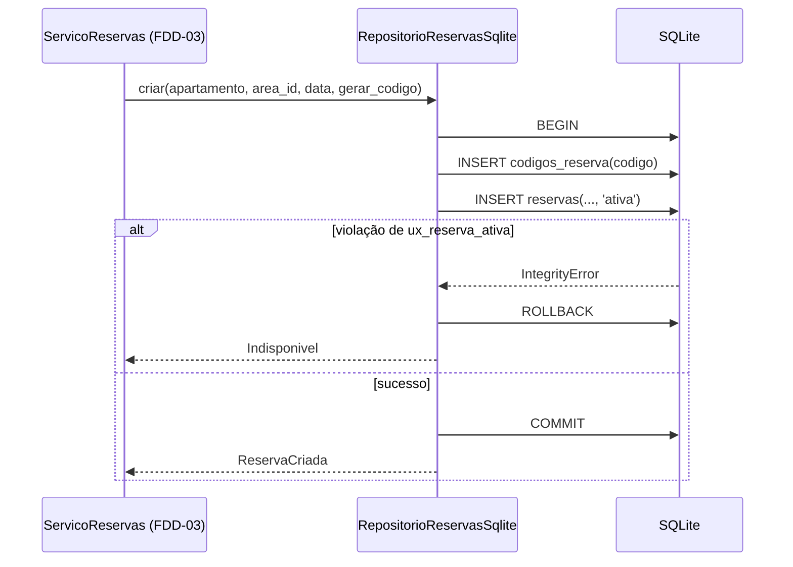

# Feature Design Document (FDD): Persistência do domínio (esquema, repositórios e exclusividade)

---
**Versão:** v1.0  
**Data:** 2026-10-30  
**Responsável:** Lucas Rocha  
**Status:** Rascunho  
**ADRs implementados:** [ADR-012](../adr/ADR-012-armazenamento-do-dominio.md), [ADR-013](../adr/ADR-013-exclusividade-de-reserva.md), [ADR-014](../adr/ADR-014-codigos-de-reserva.md) (parte de persistência), [ADR-009](../adr/ADR-009-identidade-do-apartamento.md) (índice de sessões), [ADR-016](../adr/ADR-016-ciclo-de-vida-dos-dados.md) (operações transacionais de carga)  
**Depende de:** [FDD-01](FDD-01-fundacao-e-contratos.md) (os `Protocol`s de `aurora.contratos.repositorios` e `criar_engine_sqlite`)  
**Consumido por:** FDD-03 (serviços), FDD-04 (ciclo de vida), FDD-07 (índice de sessões) e FDD-08 (montagem). Todos o consomem **apenas pelos contratos**; durante o desenvolvimento paralelo, usam os fakes do FDD-01.  
---

## 1. Contexto e motivação técnica

Os arquivos de `dados/` são imutáveis. As mudanças feitas pelo assistente precisam de um armazenamento que:

- garanta **uma reserva ativa por área e data no instante da gravação** (G5);
- nunca repita códigos de reserva, nem depois de uma restauração (RN-05);
- sobreviva a reinícios (G3).

O [ADR-012](../adr/ADR-012-armazenamento-do-dominio.md) escolheu SQLite com SQLAlchemy async. O [ADR-013](../adr/ADR-013-exclusividade-de-reserva.md) escolheu um índice único parcial. O [ADR-014](../adr/ADR-014-codigos-de-reserva.md) escolheu um registro permanente de códigos.

Esta feature é a **única dona do SQL do domínio**: nenhuma outra camada escreve SQL. Seguindo o *Repository pattern* da skill `python-design-patterns`, ela traduz entre linhas do banco e os DTOs de `aurora.contratos`, sem vazar tipos do SQLAlchemy para cima.

---

## 2. Objetivos técnicos

* Implementar `RepositorioReservas`, `RepositorioVisitantes`, `CatalogoReferencia`, `IndiceSessoes` e `RepositorioCargaInicial` sobre SQLite.
* Garantir a exclusividade de reserva **no esquema** (`ux_reserva_ativa`) e converter a violação em `Indisponivel`.
* Garantir unicidade de códigos com a tabela `codigos_reserva`, gravada **na mesma transação** que a reserva.
* Oferecer um esquema idempotente (`CREATE ... IF NOT EXISTS`) e uma restauração transacional que preserva o registro de códigos.
* Passar na **mesma suíte de testes de contrato** usada para validar os fakes do FDD-01.

---

## 3. Escopo e exclusões

### Incluído
* `aurora/persistencia/esquema.py`: DDL das tabelas e índices.
* `aurora/persistencia/repositorio_reservas.py`, `repositorio_visitantes.py`, `catalogo_referencia.py`, `indice_sessoes.py` e `carga_inicial.py`.
* `aurora/persistencia/__init__.py`, exportando as classes concretas e a fábrica `criar_repositorios(engine) -> Repositorios`.
* Testes de contrato parametrizados (fake × SQLite) e um teste de concorrência para a exclusividade.

### Excluído
* Regras de negócio: validação de data, normalização de área, política de confirmação e geração do código (FDD-03). O repositório **recebe** o gerador de código por injeção.
* Leitura dos JSON de `dados/` e o comando de restauração (FDD-04). Esta feature recebe um `DadosIniciais` já validado.
* O banco de sessões do ADK (FDD-07).

---

## 4. Fluxos detalhados e diagramas

* **Fluxo A: esquema** (`criar_esquema`, idempotente).

```sql
CREATE TABLE IF NOT EXISTS apartamentos (numero TEXT PRIMARY KEY, morador TEXT NOT NULL);
CREATE TABLE IF NOT EXISTS areas (id TEXT PRIMARY KEY, nome TEXT NOT NULL, taxa NUMERIC NOT NULL);
CREATE TABLE IF NOT EXISTS reservas (
  codigo TEXT PRIMARY KEY,
  apartamento TEXT NOT NULL REFERENCES apartamentos(numero),
  area_id TEXT NOT NULL REFERENCES areas(id),
  data TEXT NOT NULL,                      -- AAAA-MM-DD
  status TEXT NOT NULL CHECK (status IN ('ativa', 'cancelada')),
  criada_em TEXT NOT NULL, cancelada_em TEXT
);
CREATE UNIQUE INDEX IF NOT EXISTS ux_reserva_ativa ON reservas(area_id, data) WHERE status = 'ativa';
CREATE TABLE IF NOT EXISTS visitantes (
  id INTEGER PRIMARY KEY AUTOINCREMENT,
  apartamento TEXT NOT NULL REFERENCES apartamentos(numero),
  nome TEXT NOT NULL, data TEXT NOT NULL, criado_em TEXT NOT NULL
);
CREATE TABLE IF NOT EXISTS codigos_reserva (codigo TEXT PRIMARY KEY, emitido_em TEXT NOT NULL);
CREATE TABLE IF NOT EXISTS sessoes (session_id TEXT PRIMARY KEY, apartamento TEXT NOT NULL, criada_em TEXT NOT NULL);
CREATE TABLE IF NOT EXISTS metadados (chave TEXT PRIMARY KEY, valor TEXT NOT NULL);
```

* **Fluxo B: criar reserva** (`RepositorioReservas.criar`).
  1. Abrir a transação (`BEGIN IMMEDIATE` via `engine.begin()` com `isolation_level` adequado no aiosqlite).
  2. Gerar o código com `gerar_codigo()` e `INSERT INTO codigos_reserva`. Se a chave primária for violada, gerar outro código, até **5 tentativas**; esgotadas, levantar `RuntimeError` (falha de sistema).
  3. `INSERT INTO reservas (..., status='ativa')`.
  4. Se a violação for de **`ux_reserva_ativa`**, desfazer a transação (o código não fica emitido) e devolver `Indisponivel(area_id, data)`.
  5. Confirmar a transação e devolver `ReservaCriada(codigo, area_id, data)`.



* **Fluxo C: cancelar reserva.** `UPDATE reservas SET status='cancelada', cancelada_em=? WHERE apartamento=:apt AND <filtro> AND status='ativa' RETURNING codigo, area_id, data`. Sem linha afetada, o resultado é `NaoEncontrada()`. O filtro **sempre** inclui o apartamento, então uma reserva de terceiro é indistinguível de uma inexistente ([ADR-010](../adr/ADR-010-minimizacao-de-dados-nas-tools.md)).
* **Fluxo D: restaurar** (`RepositorioCargaInicial.restaurar`), numa única transação:
  1. `DELETE FROM reservas` e `DELETE FROM visitantes`;
  2. *upsert* de `apartamentos` e `areas`;
  3. `INSERT` das reservas iniciais com `status='ativa'`;
  4. `INSERT ... ON CONFLICT DO NOTHING` dos códigos iniciais em `codigos_reserva`;
  5. `INSERT` dos visitantes iniciais;
  6. *upsert* de `metadados('seed_aplicado', <timestamp>)`.

  **`codigos_reserva` nunca é apagada.** A tabela `sessoes` também não é limpa aqui; isso cabe ao `IndiceSessoes.limpar()`, chamado pelo FDD-04.

---

## 5. Contratos públicos (assinaturas, headers, exemplos)

### 5.1 Interface pública

```python
# src/aurora/persistencia/__init__.py
@dataclass(frozen=True, slots=True)
class Repositorios:
    reservas: RepositorioReservas
    visitantes: RepositorioVisitantes
    referencia: CatalogoReferencia
    sessoes: IndiceSessoes
    carga: RepositorioCargaInicial

def criar_repositorios(engine: AsyncEngine) -> Repositorios: ...

__all__ = ["Repositorios", "criar_repositorios", "RepositorioReservasSqlite",
           "RepositorioVisitantesSqlite", "CatalogoReferenciaSqlite",
           "IndiceSessoesSqlite", "RepositorioCargaInicialSqlite"]
```

As assinaturas dos métodos são exatamente as dos `Protocol`s do [FDD-01 §5.1](FDD-01-fundacao-e-contratos.md#51-interface-pública).

### 5.2 Semântica dos contratos de resposta
* `listar_ativas(apartamento)`: só reservas `ativa` daquele apartamento, ordenadas por `data` e `codigo`.
* `esta_ocupada(area_id, data)`: devolve **apenas** um booleano, sem indicar quem ocupa.
* `listar(apartamento)` (visitantes): ordenado por `data` e `id`.
* `apartamento_de(session_id)`: `None` se a sessão não estiver indexada (a API responde `404`).
* `RepositorioCargaInicial.restaurar` é **atômica**: ou tudo é aplicado, ou nada.

### 5.3 Exemplos de uso

```python
engine = criar_engine_sqlite(config.banco_dominio, busy_timeout_ms=config.sqlite_busy_timeout_ms)
repos = criar_repositorios(engine)
await repos.carga.criar_esquema()
resultado = await repos.reservas.criar(
    apartamento="101", area_id="salao-de-festas", data=date(2030, 4, 20),
    gerar_codigo=gerar_codigo_reserva,          # injetado (FDD-03)
)
```

---

## 6. Configuração e opções

* **Requisitos de Runtime:** Python 3.12+; SQLite ≥ 3.35 (suporte a `RETURNING` e índices parciais), já incluso no Python 3.12 das plataformas suportadas.
* **Armazenamento / Dependências de Infra:** arquivo `var/aurora.db` (caminho vindo de `Configuracoes.banco_dominio`).
* **Variáveis de ambiente e parâmetros:** nenhum próprio. Usa `sqlite_busy_timeout_ms` de `Configuracoes`.

```python
MAX_TENTATIVAS_CODIGO = 5      # constante do módulo repositorio_reservas
```

---

## 7. Erros, exceções e fallback

### 7.1 Concorrência e atomicidade
* **Por que é crítico:** no passo 14, duas aprovações gravam a mesma área e data ao mesmo tempo. Uma checagem prévia não impede a dupla reserva, e um lock em memória não vale como garantia do armazenamento.
* **Garantias:**
  * `ux_reserva_ativa` impede a segunda linha `ativa`, seja qual for a ordem ou o caminho de código;
  * o código emitido e a reserva gravada entram na mesma transação, sem código "órfão" nem reserva sem registro;
  * WAL e `busy_timeout` fazem o segundo escritor esperar em vez de falhar com "database is locked".

### 7.2 Tratamento de erros gerais
| Situação de Erro | Tratamento Técnico / Comportamento |
| :--- | :--- |
| `IntegrityError` em `ux_reserva_ativa` | `ROLLBACK` e retorno `Indisponivel`, **nunca** exceção |
| `IntegrityError` na chave primária de `codigos_reserva` | Nova tentativa com outro código (até 5); esgotadas, `RuntimeError` |
| Qualquer outro `IntegrityError` (chave estrangeira etc.) | Propaga como erro de sistema (indica bug ou área ou apartamento inválido não filtrado pelo FDD-03) |
| `OperationalError: database is locked` após o `busy_timeout` | Propaga; o FDD-08 o mapeia para `503` e registra em log |

### 7.3 Modo permissivo (Fallback / Fail-Open)
* **Não há fail-open.** Em dúvida sobre a exclusividade, a gravação falha. Nunca se grava sem a restrição.

---

## 8. Métricas, logs e tracing
* **Métricas:** fora de escopo.
* **Logs estruturados:**
  - `INFO reserva_criada codigo=… area_id=… data=…`;
  - `INFO reserva_indisponivel area_id=… data=…` (sem o apartamento que tentou);
  - `INFO restauracao_aplicada reservas=N visitantes=M`.
  - Nomes de visitantes não são logados.
* **Tracing:** não aplicável.

---

## 9. Dependências e compatibilidade
| Componente | Versão mínima | Observações |
| :--- | :--- | :--- |
| SQLAlchemy (async) | 2.x | Via `google-adk[db]` |
| aiosqlite | 0.21 | Via ADK |
| SQLite | 3.35 | `RETURNING` e índice parcial |
| **FDD-01** | — | `Protocol`s, DTOs, `criar_engine_sqlite` e fakes (para os testes de contrato) |
| **FDD-03** | — | Fornece `gerar_codigo_reserva` na montagem; nos testes, usa-se um gerador determinístico |

---

## 10. Critérios de aceite técnicos
* [ ] A suíte de testes de contrato passa contra o fake (FDD-01) **e** contra a implementação SQLite.
* [ ] **Teste de concorrência:** 20 chamadas simultâneas de `criar` para a mesma área e data resultam em exatamente 1 `ReservaCriada` e 19 `Indisponivel`, sem exceção.
* [ ] Cancelar e depois reservar a mesma área e data funciona (o índice parcial ignora as canceladas).
* [ ] Um código emitido nunca se repete, inclusive após `restaurar()` (teste com gerador forçado a colidir).
* [ ] `cancelar_*` com reserva de outro apartamento devolve `NaoEncontrada`, e a reserva continua `ativa`.
* [ ] `restaurar()` deixa exatamente o conteúdo de `DadosIniciais` em reservas e visitantes e mantém `codigos_reserva`.
* [ ] `criar_esquema()` executado duas vezes não falha nem altera dados.
* [ ] Nenhum tipo do SQLAlchemy aparece nas assinaturas públicas.

---

## 11. Riscos e mitigação
| Risco | Impacto | Mitigação |
| :--- | :--- | :--- |
| Distinguir a violação de `ux_reserva_ativa` de outras violações pela mensagem do SQLite | Médio | Checar o nome do índice ou das colunas na mensagem, com um teste dedicado; alternativamente, checar `esta_ocupada` **dentro** da mesma transação após a falha |
| Comportamento de transação do aiosqlite (autocommit implícito) | Médio | Usar `engine.begin()` explicitamente e testar o rollback do código emitido |
| Contenção com o banco de sessões | Baixo | Arquivos separados ([ADR-012](../adr/ADR-012-armazenamento-do-dominio.md)); transações curtas |
