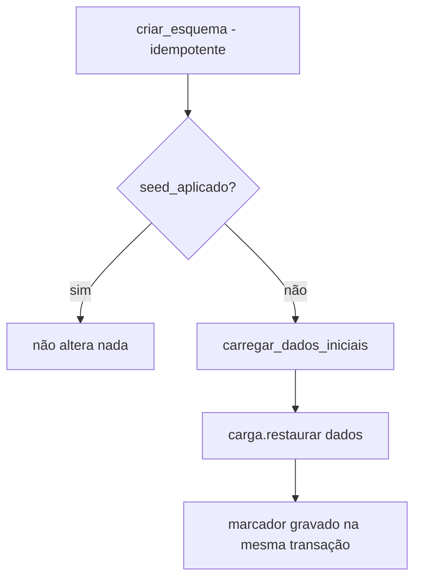

# Feature Design Document (FDD): Ciclo de vida dos dados (carga de `dados/`, inicialização e restauração)

---
**Versão:** v1.0  
**Data:** 2026-10-30  
**Responsável:** Lucas Rocha  
**Status:** Rascunho  
**ADRs implementados:** [ADR-016](../adr/ADR-016-ciclo-de-vida-dos-dados.md), [ADR-014](../adr/ADR-014-codigos-de-reserva.md) (preservação do registro de códigos)  
**Depende de:** [FDD-01](FDD-01-fundacao-e-contratos.md) (`DadosIniciais`, `RepositorioCargaInicial`, `IndiceSessoes`, `Configuracoes` e fakes)  
**Integra com, só na montagem:** FDD-02 (a implementação SQLite de `RepositorioCargaInicial` e `IndiceSessoes`) e FDD-07 (o arquivo de sessões apagado na restauração é o mesmo que o FDD-07 usa, `Configuracoes.banco_sessoes`)  
**Consumido por:** FDD-08 (chama `preparar_banco()` no `lifespan`)  
---

## 1. Contexto e motivação técnica

O avaliador parte de um **clone limpo** (passo 1), restaura os dados e sobe a API. No passo 13, ele reinicia a API **sem restaurar**, e tudo precisa continuar igual. O [ADR-016](../adr/ADR-016-ciclo-de-vida-dos-dados.md) decidiu:

- a subida cria o esquema de forma idempotente e aplica o seed **só** quando o marcador `seed_aplicado` não existe;
- a restauração é um comando separado que volta reservas e visitantes ao estado de `dados/`, preserva o registro de códigos e **apaga as sessões**, para que pendências antigas não executem sobre o estado restaurado.

Esta feature cuida da **política** do ciclo de vida e da **leitura e validação** de `dados/`. O SQL fica com o FDD-02, por trás de `RepositorioCargaInicial`. Separar as duas coisas mantém cada módulo com uma única razão para mudar (*SRP*).

---

## 2. Objetivos técnicos

* Ler e validar os quatro JSON de `dados/` num `DadosIniciais`, falhando com mensagem clara se o formato for inválido. **Nunca escrever** em `dados/`.
* `preparar_banco()`: esquema idempotente e seed condicionado ao marcador, chamado na subida da API.
* `restaurar()`: restaurar o domínio e limpar as sessões (índice e arquivo do ADK).
* Expor o comando `uv run aurora-restaurar`, funcional num clone limpo e independente da API estar rodando.

---

## 3. Escopo e exclusões

### Incluído
* `aurora/ciclo_de_vida/dados_iniciais.py`: `carregar_dados_iniciais(diretorio) -> DadosIniciais`.
* `aurora/ciclo_de_vida/inicializacao.py`: `preparar_banco(carga, dados_iniciais)`.
* `aurora/ciclo_de_vida/restauracao.py`: `restaurar(carga, indice_sessoes, banco_sessoes, dados_iniciais)`.
* `aurora/ciclo_de_vida/cli.py`: `main()`, o ponto de entrada de `aurora-restaurar` (monta o engine e os repositórios do FDD-02).
* Testes unitários com os fakes do FDD-01 e um teste de integração do comando num diretório temporário.

### Excluído
* DDL e SQL (FDD-02).
* O arquivo `regulamento.md` (FDD-05 o lê diretamente).
* Migrações de esquema entre versões (há uma única versão do esquema).
* Restauração com a API em execução (documentada como não suportada).

---

## 4. Fluxos detalhados e diagramas

* **Fluxo A: carga de `dados/`.**
  1. Ler `apartamentos.json`, `areas.json`, `reservas.json` e `visitantes.json` em UTF-8.
  2. Converter para os DTOs do FDD-01 (`taxa` → `Decimal`, `data` → `date`).
  3. Validar a consistência: reservas e visitantes referenciam apartamentos e áreas existentes; não há duas reservas ativas para a mesma área e data.
  4. Devolver `DadosIniciais`, ou levantar `DadosIniciaisInvalidos` indicando o arquivo e o registro.

* **Fluxo B: subida** (`preparar_banco`, chamado pelo FDD-08 no `lifespan`).



* **Fluxo C: restauração** (`uv run aurora-restaurar`).
  1. `carregar_configuracoes()` e `carregar_dados_iniciais(config.diretorio_dados)`. Se a carga falhar, nada é alterado.
  2. `carga.criar_esquema()` (o clone limpo ainda não tem o banco).
  3. `carga.restaurar(dados)`: uma transação que preserva `codigos_reserva` (FDD-02).
  4. `indice_sessoes.limpar()`.
  5. Remover o arquivo `config.banco_sessoes` e seus arquivos `-wal` e `-shm`, se existirem. O FDD-07 recria as tabelas do ADK no primeiro uso.
  6. Imprimir um resumo: quantas reservas e visitantes foram restaurados e se as sessões foram apagadas.

  > A ordem 3 → 4 → 5 garante que, se algo falhar depois do passo 3, o domínio já está restaurado e uma nova execução do comando completa o resto (o comando é **idempotente**).

---

## 5. Contratos públicos (assinaturas, headers, exemplos)

### 5.1 Interface pública

```python
# src/aurora/ciclo_de_vida/__init__.py
__all__ = ["carregar_dados_iniciais", "preparar_banco", "restaurar",
           "DadosIniciaisInvalidos", "ResumoRestauracao"]

class DadosIniciaisInvalidos(Exception): ...

@dataclass(frozen=True, slots=True)
class ResumoRestauracao:
    reservas: int
    visitantes: int
    sessoes_apagadas: bool

def carregar_dados_iniciais(diretorio: Path) -> DadosIniciais: ...

async def preparar_banco(carga: RepositorioCargaInicial,
                         dados_iniciais: Callable[[], DadosIniciais]) -> bool: ...   # True se aplicou o seed

async def restaurar(*, carga: RepositorioCargaInicial, indice_sessoes: IndiceSessoes,
                    banco_sessoes: Path, dados: DadosIniciais) -> ResumoRestauracao: ...
```

```python
# src/aurora/ciclo_de_vida/cli.py
def main() -> None: ...      # [project.scripts] aurora-restaurar = "aurora.ciclo_de_vida.cli:main"
```

### 5.2 Semântica dos contratos de resposta
* `preparar_banco` recebe uma *factory* (`Callable`) de `DadosIniciais`, de modo que os JSON **só são lidos** quando o seed é necessário.
* `restaurar` é idempotente: executá-lo duas vezes seguidas gera o mesmo estado.
* Código de saída do CLI: `0` em caso de sucesso; `1` para dados inválidos; `2` quando o banco está travado (provavelmente com a API em execução), com mensagem pedindo para parar a API.

### 5.3 Exemplos de uso

```bash
cp .env.example .env    # preencher GOOGLE_API_KEY
uv sync
uv run aurora-restaurar
# Restauração concluída: 3 reservas, 2 visitantes; sessões apagadas.
uv run aurora-api
```

---

## 6. Configuração e opções

* **Requisitos de Runtime:** Python 3.12+.
* **Armazenamento / Dependências de Infra:** lê `dados/`; escreve em `var/aurora.db` (via FDD-02) e remove `var/sessions.db*`.
* **Variáveis de ambiente e parâmetros:** nenhuma própria. Usa `Configuracoes.diretorio_dados`, `banco_dominio` e `banco_sessoes`. O comando de restauração **não exige** `GOOGLE_API_KEY`, porque usa uma variante de `carregar_configuracoes` que não valida a chave.

---

## 7. Erros, exceções e fallback

### 7.1 Concorrência e atomicidade
* **Por que é crítico:** uma restauração parcial (reservas apagadas e não reinseridas) deixaria o condomínio sem dados.
* **Garantias:** a restauração do domínio é **uma única transação** (FDD-02). A limpeza de sessões vem depois e é idempotente. A restauração concorrente com a API não é suportada: o `busy_timeout` falha e o CLI orienta a parar a API.

### 7.2 Tratamento de erros gerais
| Situação de Erro | Tratamento Técnico / Comportamento |
| :--- | :--- |
| JSON malformado ou com referência inconsistente | `DadosIniciaisInvalidos`; nada é alterado; saída `1` |
| Banco travado (API em execução) | Mensagem orientando a parar a API; saída `2` |
| `var/` inexistente (clone limpo) | Criado pela fábrica de engine (FDD-01) |
| Arquivo de sessões inexistente | Ignorado (`missing_ok=True`) |

### 7.3 Modo permissivo (Fallback / Fail-Open)
* Não se aplica. O `preparar_banco` **nunca** restaura um banco já semeado, mesmo que ele esteja vazio.

---

## 8. Métricas, logs e tracing
* **Métricas:** fora de escopo.
* **Logs estruturados:**
  - `INFO seed_inicial_aplicado reservas=N visitantes=M`, apenas na primeira subida;
  - `INFO restauracao_concluida reservas=N visitantes=M sessoes_apagadas=true`.
* **Tracing:** não aplicável.

---

## 9. Dependências e compatibilidade
| Componente | Versão mínima | Observações |
| :--- | :--- | :--- |
| Python | 3.12 | `json`, `pathlib`, `decimal` |
| **FDD-01** | — | `DadosIniciais`, `Protocol`s e fakes |
| **FDD-02** | — | Implementação SQLite de `RepositorioCargaInicial` e `IndiceSessoes` (só no `cli.py` e na montagem); **não bloqueia** o desenvolvimento |
| **FDD-07** | — | Convenção compartilhada: o arquivo de sessões é `Configuracoes.banco_sessoes` |

---

## 10. Critérios de aceite técnicos
* [ ] Num clone limpo, `uv run aurora-restaurar` termina com código `0`, e as rotas de verificação mostram `RSV-1377` para o 101 e Marina Duarte para o 302 (com o FDD-08 integrado).
* [ ] `preparar_banco` sobre um banco já semeado **não altera** nenhum registro, mesmo com todas as reservas canceladas.
* [ ] Após restaurar, códigos emitidos antes da restauração continuam no registro (teste com o fake e com SQLite).
* [ ] Após restaurar, o arquivo de sessões não existe e o índice de sessões está vazio.
* [ ] Os arquivos de `dados/` permanecem byte a byte iguais (teste por hash antes e depois).
* [ ] Um JSON inválido num diretório temporário faz o CLI sair com `1` sem alterar o banco.

---

## 11. Riscos e mitigação
| Risco | Impacto | Mitigação |
| :--- | :--- | :--- |
| Restauração executada com a API rodando | Médio | `busy_timeout` resulta em saída `2` com instrução; o README documenta a ordem dos comandos |
| Remover o arquivo de sessões enquanto o processo da API o mantém aberto | Médio | Mesma mitigação; com a API parada, não há handles abertos |
| Formato de `dados/` diferente do esperado no repositório base | Baixo | Validação explícita com mensagens que apontam o arquivo e o campo |
