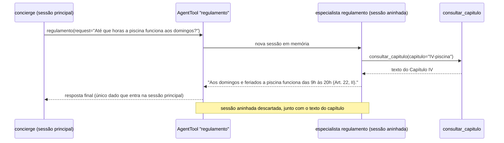

# Feature Design Document (FDD): Consulta ao regulamento (índice por capítulo e especialista isolado)

---
**Versão:** v1.0  
**Data:** 2026-10-30  
**Responsável:** Lucas Rocha  
**Status:** Rascunho  
**ADRs implementados:** [ADR-015](../adr/ADR-015-consulta-ao-regulamento.md), [ADR-003](../adr/ADR-003-topologia-de-agentes.md) (especialista `regulamento` como `AgentTool`)  
**Depende de:** [FDD-01](FDD-01-fundacao-e-contratos.md) (`Configuracoes` e `criar_modelo`)  
**Consumido por:** FDD-06, que recebe a tool pronta (`BaseTool`) e a anexa ao `concierge`. O contrato é a função `criar_ferramenta_regulamento`; o FDD-06 pode desenvolver com uma tool stub até esta feature ficar pronta.  
---

## 1. Contexto e motivação técnica

O regulamento tem cerca de 44 KB e 14 capítulos. A garantia G4 exige que o agente principal **não o receba nas instruções** e que **nenhum evento da sessão contenha trechos de capítulos que tratam de outros assuntos**.

Busca por palavra-chave falha: termos como "horas" e "funciona" aparecem nos capítulos III, V, IX e X, além do IV (piscina). O [ADR-015](../adr/ADR-015-consulta-ao-regulamento.md) decidiu:

- indexar o arquivo por capítulo, de forma determinística;
- oferecer uma tool que recebe **um identificador de um conjunto fechado** e devolve um único capítulo;
- executar o especialista como `AgentTool`. A sessão aninhada é descartada (verificado em `google/adk/tools/agent_tool.py` na 2.13.0), então o texto do capítulo nunca entra na sessão principal; só a resposta final entra.

Esta feature é **autocontida** (vertical): índice, tool, instruções e agente. Para o resto do sistema, ela expõe uma única fábrica.

---

## 2. Objetivos técnicos

* Indexar `dados/regulamento.md` por capítulo, com identificadores estáveis (ex.: `IV-piscina`).
* Expor a tool `consultar_capitulo(capitulo: <enum fechado>)`, que devolve o texto de **um** capítulo.
* Construir o especialista `regulamento` (`LlmAgent`), com a lista de capítulos **nas instruções**, e embrulhá-lo em `AgentTool`.
* Garantir que a resposta do especialista é concisa, cita o artigo e se limita ao tema perguntado.
* Validar com o caso de referência: piscina aos domingos → **20h** (Art. 22, II), e não 22h.

---

## 3. Escopo e exclusões

### Incluído
* `aurora/regulamento/indice.py`: `Capitulo` e `IndiceRegulamento.carregar(caminho)`.
* `aurora/regulamento/ferramenta_capitulo.py`: a fábrica da tool `consultar_capitulo`, com o enum gerado do índice.
* `aurora/regulamento/instrucoes.py`: o texto das instruções do especialista, com o sumário injetado.
* `aurora/regulamento/agente.py`: `criar_especialista_regulamento(...)` e `criar_ferramenta_regulamento(...)`.
* Testes do índice (14 capítulos, limites corretos) e um teste de isolamento (a sessão principal não contém o texto do capítulo).

### Excluído
* A decisão de **quando** consultar o regulamento (o `concierge`, no FDD-06, decide chamar a tool).
* Busca semântica, embeddings ou RAG (descartados no ADR-015).
* Recorte por artigo.

---

## 4. Fluxos detalhados e diagramas

* **Fluxo A: indexação** (na montagem, uma vez).
  1. Ler o arquivo em UTF-8.
  2. Dividir nas linhas que casam com `^## Capítulo (?P<romano>[IVXLC]+): (?P<tema>.+)$`.
  3. Para cada capítulo, montar `id = f"{romano}-{slug(tema)}"` (ex.: `IV-piscina`, `VI-salao-de-festas-churrasqueira-e-quadra`), `titulo` e `texto` (do cabeçalho até o próximo cabeçalho de capítulo).
  4. Validar que há 14 capítulos e que os `id`s são únicos; caso contrário, falhar na montagem.

* **Fluxo B: consulta** (dentro da sessão aninhada do `AgentTool`).



* **Fluxo C: instruções do especialista** (resumo):
  1. "Você responde dúvidas **somente** com base no regulamento interno."
  2. "Escolha o capítulo pelo **tema** da pergunta, usando a lista abaixo; consulte mais de um apenas se a pergunta envolver mais de um tema."
  3. "Responda em até três frases, citando o artigo e o inciso. Não transcreva o capítulo."
  4. "Se a regra não existir no capítulo consultado, diga que não encontrou."
  5. A lista de capítulos (`id` e título) é gerada a partir do índice.

---

## 5. Contratos públicos (assinaturas, headers, exemplos)

### 5.1 Interface pública

```python
# src/aurora/regulamento/__init__.py
__all__ = ["Capitulo", "IndiceRegulamento", "criar_ferramenta_regulamento"]

@dataclass(frozen=True, slots=True)
class Capitulo:
    id: str          # "IV-piscina"
    titulo: str      # "Capítulo IV: Piscina"
    texto: str

class IndiceRegulamento:
    @classmethod
    def carregar(cls, caminho: Path) -> "IndiceRegulamento": ...
    def capitulos(self) -> tuple[Capitulo, ...]: ...
    def obter(self, capitulo_id: str) -> Capitulo | None: ...

def criar_ferramenta_regulamento(*, configuracoes: Configuracoes,
                                 indice: IndiceRegulamento | None = None) -> BaseTool:
    """Devolve AgentTool(agent=especialista 'regulamento'). Contrato consumido pelo FDD-06."""
```

### 5.2 Semântica dos contratos de resposta
* `consultar_capitulo` devolve `{"capitulo": id, "titulo": ..., "texto": ...}`. Para um `id` fora do enum (defesa extra), devolve `{"erro": "capitulo_inexistente"}`, sem texto.
* A resposta do `AgentTool` para o `concierge` é **texto curto** com a citação do artigo.
* Nome e descrição da tool vista pelo `concierge`:
  - nome: `regulamento`;
  - descrição: "Responde dúvidas sobre o regulamento interno do condomínio (horários, uso das áreas comuns, regras de convivência). Envie a pergunta do morador."

### 5.3 Exemplos de uso

```python
# Montagem (FDD-08) ou testes
ferramenta = criar_ferramenta_regulamento(configuracoes=config)
concierge = criar_concierge(..., ferramenta_regulamento=ferramenta)   # FDD-06
```

---

## 6. Configuração e opções

* **Requisitos de Runtime:** Python 3.12+, ADK 2.13.0.
* **Armazenamento / Dependências de Infra:** leitura de `dados/regulamento.md`; nenhum armazenamento próprio.
* **Variáveis de ambiente e parâmetros:** usa `Configuracoes.modelo` e `temperatura` (via `criar_modelo`).

```python
NOME_FERRAMENTA = "regulamento"
PADRAO_CAPITULO = r"^## Capítulo (?P<romano>[IVXLC]+): (?P<tema>.+)$"
CAPITULOS_ESPERADOS = 14
```

---

## 7. Erros, exceções e fallback

### 7.1 Concorrência e atomicidade
* **Por que é crítico:** não há escrita. O índice é imutável e compartilhado entre requisições.
* **Garantias:** `IndiceRegulamento` é imutável (tuplas e dataclasses congeladas) e seguro para leitura concorrente. Cada chamada do `AgentTool` cria a própria sessão aninhada.

### 7.2 Tratamento de erros gerais
| Situação de Erro | Tratamento Técnico / Comportamento |
| :--- | :--- |
| Arquivo ausente ou com contagem de capítulos diferente de 14 | Falha na montagem (fail-fast), com mensagem indicando o arquivo |
| Modelo pede um capítulo inexistente | `{"erro": "capitulo_inexistente"}`, sem texto de nenhum capítulo |
| Falha do modelo dentro do `AgentTool` | O `AgentTool` devolve texto de erro ao `concierge`, que responde que não conseguiu consultar agora; nenhum texto de capítulo vaza |

### 7.3 Modo permissivo (Fallback / Fail-Open)
* **Não há fallback** para "carregar o regulamento inteiro". Se a consulta falhar, o assistente informa que não conseguiu consultar.

---

## 8. Métricas, logs e tracing
* **Métricas:** fora de escopo.
* **Logs estruturados:** `INFO regulamento_consultado capitulo=IV-piscina`. O texto da pergunta não é logado.
* **Tracing:** spans nativos do ADK, se habilitados; nenhum exportador neste escopo.

---

## 9. Dependências e compatibilidade
| Componente | Versão mínima | Observações |
| :--- | :--- | :--- |
| `google-adk` | 2.13.0 | `AgentTool` com sessão aninhada em memória; uso desencorajado pela documentação, aceito no ADR-003 |
| **FDD-01** | — | `Configuracoes` e `criar_modelo` |
| **FDD-06** | — | Consumidor da tool; nenhuma dependência na direção contrária |

---

## 10. Critérios de aceite técnicos
* [ ] O índice encontra 14 capítulos com os títulos de [SUMMARY §4.5](../SUMMARY.md#45-regulamento--dadosregulamentomd), e o Capítulo IV contém o Art. 22.
* [ ] `consultar_capitulo("IV-piscina")` devolve apenas o texto entre o cabeçalho do Capítulo IV e o do Capítulo V.
* [ ] **Teste de isolamento:** depois de uma consulta via `concierge`, os eventos da sessão principal não contêm o texto bruto de nenhum capítulo (ex.: o texto do Art. 23) nem frases de outros capítulos (ex.: "período de silêncio", Art. 16).
* [ ] Para "Até que horas a piscina funciona aos domingos?", a resposta contém "20h".
* [ ] O agente principal (FDD-06) não contém nenhuma linha do regulamento nas instruções. Esse critério é verificado em conjunto com o FDD-06.

---

## 11. Riscos e mitigação
| Risco | Impacto | Mitigação |
| :--- | :--- | :--- |
| O especialista copiar trechos longos do capítulo na resposta final, que é gravada na sessão principal | Médio | Instruções de concisão e citação; o teste de isolamento procura frases de outros capítulos e o texto bruto |
| O especialista escolher o capítulo errado | Médio | Títulos descritivos na instrução; permitido consultar mais de um capítulo quando necessário |
| Mudança futura no `AgentTool` (ex.: passar a persistir a sessão aninhada) | Médio | Versão fixada ([ADR-002](../adr/ADR-002-versao-do-google-adk.md)); o teste de isolamento falha se o comportamento mudar |
