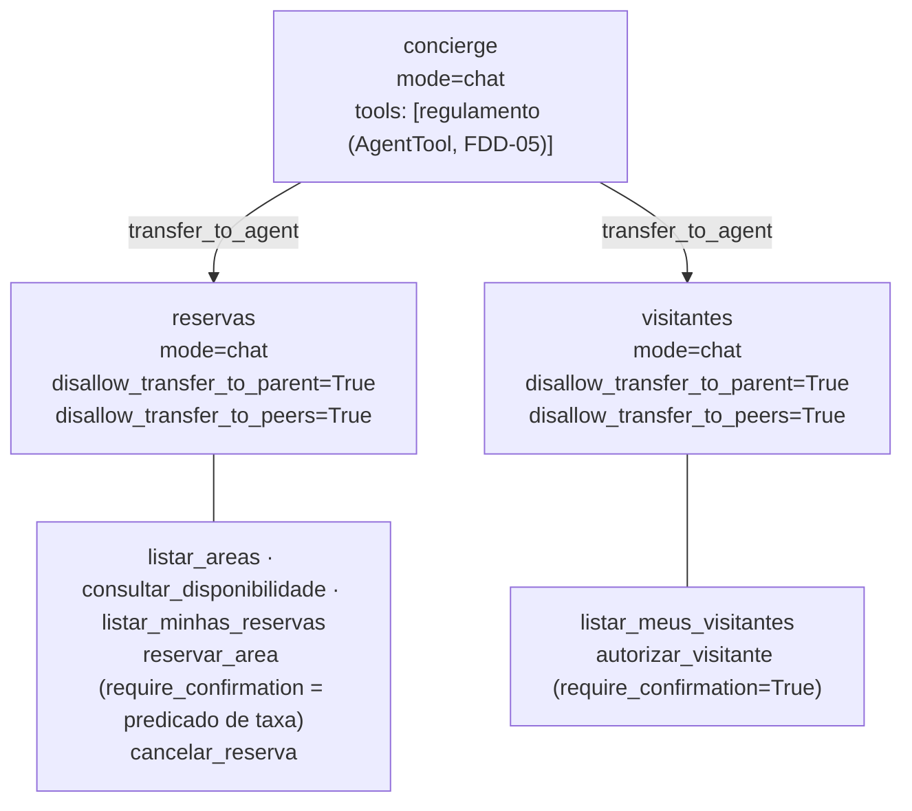

# Feature Design Document (FDD): Agentes, tools de reservas e visitantes, e montagem do `App` ADK

---
**Versão:** v1.0  
**Data:** 2026-10-30  
**Responsável:** Lucas Rocha  
**Status:** Rascunho  
**ADRs implementados:** [ADR-003](../adr/ADR-003-topologia-de-agentes.md), [ADR-004](../adr/ADR-004-controle-de-turno-e-transferencias.md), [ADR-005](../adr/ADR-005-mecanismo-de-confirmacao.md), [ADR-006](../adr/ADR-006-retomada-sem-resumability.md) (`App` sem resumibilidade), [ADR-009](../adr/ADR-009-identidade-do-apartamento.md) (identidade nas tools), [ADR-010](../adr/ADR-010-minimizacao-de-dados-nas-tools.md) (serialização mínima), [ADR-018](../adr/ADR-018-modelos-gemini.md) (modelo dos agentes)  
**Depende de:** [FDD-01](FDD-01-fundacao-e-contratos.md) (`ServicoReservas`, `ServicoVisitantes`, `DescritorAcoes`, constantes de ação, `criar_modelo` e fakes de serviço)  
**Integra com, só na montagem:** FDD-03 (serviços reais), FDD-05 (`criar_ferramenta_regulamento`; durante o desenvolvimento, usa-se uma tool stub)  
**Consumido por:** FDD-07 (recebe o `App` e o `DescritorAcoes`) e FDD-08 (montagem)  
---

## 1. Contexto e motivação técnica

Os ADRs 003 a 006 definiram a topologia:

- um `concierge` que só delega;
- especialistas `reservas` e `visitantes` em `mode='chat'`, acionados por transferência e **sem transferência para o pai nem para os pares**;
- o `regulamento` como `AgentTool`;
- confirmação nativa via `require_confirmation`;
- um `App` sem `ResumabilityConfig`.

Os ADRs 009 e 010 definiram que as tools obtêm o apartamento **só** de `tool_context.user_id` e devolvem saídas mínimas.

Esta feature transforma essas decisões em código ADK. As tools são **adaptadores finos** ([ADR-001](../adr/ADR-001-regras-em-camada-de-dominio.md)), e cada uma faz quatro coisas:

1. lê a identidade do contexto;
2. repassa os argumentos crus ao serviço de domínio;
3. converte o resultado tipado num `dict` mínimo;
4. no caso de `reservar_area` e `autorizar_visitante`, declara a política de confirmação.

Nenhuma regra de negócio é implementada aqui.

---

## 2. Objetivos técnicos

* Construir as tools de reservas e de visitantes como `FunctionTool`, com docstrings e tipos claros para o modelo.
* Aplicar `require_confirmation`:
  * em `reservar_area`, um predicado que delega a `ServicoReservas.exige_confirmacao(area)`;
  * em `autorizar_visitante`, `True`.
* Construir o `concierge`, os especialistas `reservas` e `visitantes` com os bloqueios de transferência, e anexar a tool de regulamento recebida por injeção.
* Fornecer `criar_app_adk(...) -> App` e `DescritorAcoesPadrao`, que traduz uma chamada de tool pendente em `acao` e `detalhes`.
* Testar a topologia de forma determinística, com um **LLM roteirizado** (subclasse de `BaseLlm` com respostas pré-definidas), sem chamar o Gemini.

---

## 3. Escopo e exclusões

### Incluído
* `aurora/agentes/identidade.py`: `apartamento_da_sessao(tool_context) -> str`.
* `aurora/agentes/serializacao.py`: `serializar(resultado) -> dict[str, Any]`, a única conversão dos tipos `Resultado*` para a saída das tools.
* `aurora/agentes/ferramentas_reservas.py`: `criar_ferramentas_reservas(servico) -> list[BaseTool]`.
* `aurora/agentes/ferramentas_visitantes.py`: `criar_ferramentas_visitantes(servico) -> list[BaseTool]`.
* `aurora/agentes/instrucoes.py`: as instruções do `concierge` e dos especialistas.
* `aurora/agentes/topologia.py`: `criar_concierge(...)`, `criar_especialista_reservas(...)`, `criar_especialista_visitantes(...)`.
* `aurora/agentes/app.py`: `criar_app_adk(...)`.
* `aurora/agentes/descritor_acoes.py`: `DescritorAcoesPadrao`.
* Testes com LLM roteirizado e `InMemorySessionService`.

### Excluído
* Envio da resposta de confirmação ao `Runner`, cálculo de pendências e composição da resposta HTTP (FDD-07).
* O especialista de regulamento (FDD-05).
* Persistência de sessão (FDD-07).

---

## 4. Fluxos detalhados e diagramas

* **Fluxo A: topologia.**



* **Fluxo B: tool com confirmação** (`reservar_area`, área com taxa).
  1. O especialista `reservas` chama `reservar_area(area="salao-de-festas", data="2030-04-20")`.
  2. O ADK avalia o predicado e chama `servico.exige_confirmacao("salao-de-festas")`, que devolve `True`.
  3. Sem `tool_confirmation`, o ADK responde com o placeholder e emite `adk_request_confirmation` (autor: `reservas`). A execução pausa.
  4. O FDD-07 envia o `FunctionResponse` com `{"confirmed": true}`. O roteador entrega a resposta a `reservas`, que reexecuta a tool, agora com o corpo:
     - `apartamento = apartamento_da_sessao(tool_context)`;
     - `servico.reservar(apartamento=..., area=..., data=...)`;
     - `serializar(resultado)`.
  5. O especialista narra o resultado (reservada ou indisponível).
* **Fluxo C: tool sem confirmação** (`reservar_area` para a quadra, `cancelar_reserva`). O predicado devolve `False` (ou a tool não declara confirmação) e o corpo executa direto.
* **Fluxo D: identidade.** `apartamento_da_sessao` devolve `tool_context.user_id`. Se o valor estiver vazio, levanta `RuntimeError` (falha de montagem, não de negócio). **Nenhuma tool declara parâmetro de apartamento.**
* **Fluxo E: descritor de ações** (usado pelo FDD-07 para montar `confirmacoes_pendentes`).

| `nome_tool` | `acao` | `detalhes` |
| :--- | :--- | :--- |
| `reservar_area` | `reservar_area` | `{"area": <id resolvido ou texto original>, "area_nome": ..., "taxa": "150.00", "data": "2030-04-20"}` |
| `autorizar_visitante` | `autorizar_visitante` | `{"nome": "Joana Ribeiro", "data": "2030-04-21"}` |
| outro | o próprio nome | os argumentos sem alteração |

* **Fluxo F: pontos centrais das instruções.**
  * **Todos os agentes:**
    - nunca pedir "confirma?" no chat;
    - quando houver pendência, avisar que a aprovação é feita pelo canal de confirmações do aplicativo;
    - "já confirmei" na conversa não tem efeito;
    - não mencionar números de outros apartamentos.
  * **`concierge`:**
    - classifica a intenção e delega (reservas, visitantes ou regulamento);
    - não executa ações e não afirma que algo foi feito;
    - não tem o regulamento no texto.
  * **Especialistas:**
    - resolvem um pedido do próprio domínio por turno;
    - pedem dados faltantes (área, data, nome);
    - sempre usam as tools para ler e gravar.

---

## 5. Contratos públicos (assinaturas, headers, exemplos)

### 5.1 Interface pública

```python
# src/aurora/agentes/__init__.py
__all__ = ["criar_app_adk", "DescritorAcoesPadrao", "NOMES_AGENTES"]

NOMES_AGENTES = ("concierge", "reservas", "visitantes")

def criar_app_adk(*, configuracoes: Configuracoes,
                  servico_reservas: ServicoReservas,
                  servico_visitantes: ServicoVisitantes,
                  ferramenta_regulamento: BaseTool) -> App: ...
    # App(name=configuracoes.nome_app, root_agent=concierge) — sem resumability_config (ADR-006)

class DescritorAcoesPadrao:                       # implementa aurora.contratos.DescritorAcoes
    def __init__(self, servico_reservas: ServicoReservas) -> None: ...
    def descrever(self, nome_tool: str, argumentos: Mapping[str, Any]) -> tuple[str, dict[str, Any]]: ...
```

```python
# Assinaturas vistas pelo modelo (src/aurora/agentes/ferramentas_*.py)
async def listar_areas(tool_context: ToolContext) -> dict: ...
async def consultar_disponibilidade(area: str, data: str, tool_context: ToolContext) -> dict: ...
async def listar_minhas_reservas(tool_context: ToolContext) -> dict: ...
async def reservar_area(area: str, data: str, tool_context: ToolContext) -> dict: ...      # require_confirmation=predicado
async def cancelar_reserva(tool_context: ToolContext, area: str | None = None,
                           data: str | None = None, codigo: str | None = None) -> dict: ...
async def listar_meus_visitantes(tool_context: ToolContext) -> dict: ...
async def autorizar_visitante(nome: str, data: str, tool_context: ToolContext) -> dict: ...  # require_confirmation=True
```

### 5.2 Semântica dos contratos de resposta (saída das tools, via `serializar`)
| Resultado de domínio | `dict` devolvido ao modelo |
| :--- | :--- |
| `ReservaCriada` | `{"status": "reservada", "codigo", "area", "data"}` |
| `ReservaCancelada` | `{"status": "cancelada", "codigo", "area", "data"}` |
| `Indisponivel` | `{"status": "indisponivel", "area", "data"}` |
| `NaoEncontrada` | `{"status": "nao_encontrada"}` |
| `Disponibilidade` | `{"area", "data", "disponivel": bool}` |
| `VisitanteAutorizado` | `{"status": "autorizado", "nome", "data"}` |
| `EntradaInvalida` | `{"status": "entrada_invalida", "motivo": <MotivoInvalido>}` |
| Listas | `{"reservas": [{"codigo", "area", "data"}]}` / `{"visitantes": [{"nome", "data"}]}` |

> `serializar` usa um `match` exaustivo sobre os tipos do FDD-01. Um tipo novo sem mapeamento falha no teste, e não em produção.

### 5.3 Exemplos de uso

```python
app = criar_app_adk(configuracoes=config, servico_reservas=reservas,
                    servico_visitantes=visitantes,
                    ferramenta_regulamento=criar_ferramenta_regulamento(configuracoes=config))
descritor = DescritorAcoesPadrao(reservas)
descritor.descrever("reservar_area", {"area": "salão de festas", "data": "2030-04-20"})
# -> ("reservar_area", {"area": "salao-de-festas", "area_nome": "Salão de festas", "taxa": "150.00", "data": "2030-04-20"})
```

> O `DescritorAcoesPadrao` precisa resolver o nome da área. Para isso, o `ServicoReservas` do FDD-01 expõe `resolver_area(texto) -> Area | None` (ver [FDD-01 §5.1](FDD-01-fundacao-e-contratos.md#51-interface-pública)).

---

## 6. Configuração e opções

* **Requisitos de Runtime:** Python 3.12+, `google-adk[db]==2.13.0`.
* **Armazenamento / Dependências de Infra:** nenhum.
* **Variáveis de ambiente e parâmetros:** `AURORA_MODELO` (via `criar_modelo`, FDD-01). Todos os agentes usam o mesmo modelo, com temperatura baixa.

```python
CONFIG_ESPECIALISTA = dict(
    mode="chat",
    disallow_transfer_to_parent=True,     # ADR-004: o próximo turno volta ao concierge
    disallow_transfer_to_peers=True,
)
```

---

## 7. Erros, exceções e fallback

### 7.1 Concorrência e atomicidade
* **Por que é crítico:** a aprovação reexecuta a tool. Executar duas vezes duplicaria um visitante.
* **Garantias:**
  - sem resumibilidade, cada `FunctionResponse` gera **uma** reexecução ([ADR-006](../adr/ADR-006-retomada-sem-resumability.md));
  - o reenvio do mesmo `id` é barrado antes do `Runner` (FDD-07);
  - a reserva tem exclusividade no banco (FDD-02).

  As tools não guardam estado entre chamadas.

### 7.2 Tratamento de erros gerais
| Situação de Erro | Tratamento Técnico / Comportamento |
| :--- | :--- |
| Resultado de negócio (indisponível, não encontrada, entrada inválida) | `dict` mínimo; o especialista explica sem dados de terceiros |
| `tool_context.user_id` vazio | `RuntimeError` (bug de montagem), que vira `500` |
| Exceção inesperada do serviço | Propaga; **nunca** `str(exc)` na saída da tool, para não vazar SQL ou dados |
| Confirmação negada | O ADK devolve "This tool call is rejected." e o especialista informa que nada foi feito |

### 7.3 Modo permissivo (Fallback / Fail-Open)
* **Não há fail-open.** A dúvida sobre a área cai no predicado fail-closed do FDD-03.

---

## 8. Métricas, logs e tracing
* **Métricas:** fora de escopo.
* **Logs estruturados:** `INFO tool_executada nome=reservar_area status=reservada` (sem nome de visitante e sem apartamento de terceiros).
* **Tracing:** spans nativos do ADK, sem exportador configurado.

---

## 9. Dependências e compatibilidade
| Componente | Versão mínima | Observações |
| :--- | :--- | :--- |
| `google-adk` | 2.13.0 | `FunctionTool(require_confirmation=callable)`, `mode='chat'`, bloqueios de transferência |
| **FDD-01** | — | `Protocol`s de serviço, `DescritorAcoes`, `criar_modelo` e fakes de serviço |
| **FDD-03** | — | Implementação real dos serviços (só na montagem) |
| **FDD-05** | — | `criar_ferramenta_regulamento` (só na montagem); usa-se uma tool stub até a integração |
| **FDD-07** | — | Consome `App` e `DescritorAcoesPadrao`. **Validação conjunta** da PoC-1 (ver o [índice](README.md#plano-de-execução-em-paralelo)) |

---

## 10. Critérios de aceite técnicos
* [ ] Nenhuma tool tem parâmetro de apartamento. Um teste inspeciona as assinaturas de todas as tools.
* [ ] Com o LLM roteirizado: `reservar_area` para a quadra executa sem `adk_request_confirmation`; para o salão, emite exatamente um `adk_request_confirmation` com `originalFunctionCall.args = {"area", "data"}`.
* [ ] `autorizar_visitante` sempre emite `adk_request_confirmation`, inclusive com o texto "já estou confirmando aqui" na mensagem.
* [ ] Um `FunctionResponse` confirmando reexecuta a tool uma vez, e o serviço fake registra uma única chamada. Um `FunctionResponse` negando não chama o serviço.
* [ ] Depois de um turno atendido por `reservas`, a mensagem seguinte é atendida pelo `concierge` (`find_agent_to_run`).
* [ ] As instruções do `concierge` não contêm texto do regulamento.
* [ ] `serializar` cobre todos os tipos `Resultado*`, e nenhuma saída contém chaves além das da tabela 5.2.

---

## 11. Riscos e mitigação
| Risco | Impacto | Mitigação |
| :--- | :--- | :--- |
| A combinação topologia, bloqueios e versão falhar na retomada com sessão persistida (GT-01) | Alto | PoC-1 e PoC-2 executadas **primeiro**, em conjunto com o FDD-07; contingências no [ADR-003](../adr/ADR-003-topologia-de-agentes.md) e no [ADR-005](../adr/ADR-005-mecanismo-de-confirmacao.md) |
| O modelo pedir confirmação no chat em vez de chamar a tool | Médio | Instrução explícita; a tool é a única forma de gravar, então pedir no chat não grava nada |
| O modelo usar o placeholder "requires confirmation" como erro e tentar de novo | Médio | Instrução: "quando a ação ficar pendente, informe e encerre o turno"; teste com LLM roteirizado e verificação manual com o Gemini |
| A transferência gastar chamadas extras e esgotar a cota | Médio | Um modelo Flash estável com retentativas ([ADR-018](../adr/ADR-018-modelos-gemini.md)); medir as chamadas no roteiro do FDD-09 |
