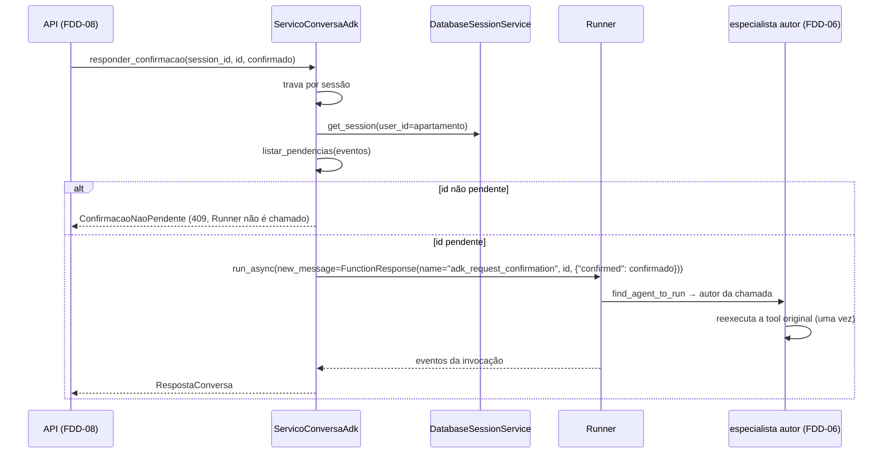

# Feature Design Document (FDD): Serviço de conversa, sessões persistentes e confirmações

---
**Versão:** v1.0  
**Data:** 2026-10-30  
**Responsável:** Lucas Rocha  
**Status:** Rascunho  
**ADRs implementados:** [ADR-006](../adr/ADR-006-retomada-sem-resumability.md), [ADR-007](../adr/ADR-007-fonte-de-verdade-das-confirmacoes.md), [ADR-008](../adr/ADR-008-mensagens-com-confirmacao-pendente.md), [ADR-009](../adr/ADR-009-identidade-do-apartamento.md) (criação de sessão com `user_id` = apartamento), [ADR-011](../adr/ADR-011-servico-de-sessao-persistente.md), [ADR-017](../adr/ADR-017-api-e-modelo-de-execucao.md) (lock por sessão, composição da resposta, serialização de eventos)  
**Depende de:** [FDD-01](FDD-01-fundacao-e-contratos.md) (`ServicoConversa`, DTOs e exceções de aplicação, `IndiceSessoes`, `CatalogoReferencia`, `DescritorAcoes`, `criar_engine_sqlite` e fakes)  
**Integra com, só na montagem:** FDD-06 (`App` e `DescritorAcoesPadrao`), FDD-02 (`IndiceSessoes` e `CatalogoReferencia` em SQLite)  
**Consumido por:** FDD-08, pelo `Protocol` `ServicoConversa`  
---

## 1. Contexto e motivação técnica

É a camada de aplicação entre a API HTTP e o runtime do ADK. Ela concentra o ponto mais arriscado do desafio (GT-01): **devolver a resposta do morador ao agente que pediu a confirmação e retomar a execução**, com sessão persistida e após reinício.

Decisões que esta feature implementa:

- **Sessões** no `DatabaseSessionService` sobre SQLite próprio, com WAL e `busy_timeout` ([ADR-011](../adr/ADR-011-servico-de-sessao-persistente.md)).
- **`user_id` igual ao apartamento**, mais o índice `session_id` → apartamento ([ADR-009](../adr/ADR-009-identidade-do-apartamento.md)).
- **Pendências derivadas dos eventos:** uma chamada `adk_request_confirmation` sem `FunctionResponse` posterior ([ADR-007](../adr/ADR-007-fonte-de-verdade-das-confirmacoes.md)).
- **`409` antes de chamar o `Runner`** quando o `id` não está pendente.
- **Retomada como nova invocação**, enviando um `FunctionResponse` `adk_request_confirmation` com `{"confirmed": bool}` ([ADR-005](../adr/ADR-005-mecanismo-de-confirmacao.md), [ADR-006](../adr/ADR-006-retomada-sem-resumability.md)).
- **Mensagens novas aceitas** com pendência aberta ([ADR-008](../adr/ADR-008-mensagens-com-confirmacao-pendente.md)).
- **Lock por sessão** e serialização completa de eventos ([ADR-017](../adr/ADR-017-api-e-modelo-de-execucao.md)).

A feature depende do `App` (FDD-06) **apenas pela interface do ADK**. Para desenvolver e testar em paralelo, ela usa um **agente de teste próprio**: uma tool com `require_confirmation=True` mais o LLM roteirizado. Com ele, executa as PoCs 1 a 4 sem esperar o FDD-06.

---

## 2. Objetivos técnicos

* Implementar `ServicoConversaAdk`, conforme o `Protocol` `ServicoConversa` do FDD-01.
* Criar o `DatabaseSessionService` com um engine próprio (`criar_servico_sessao`).
* Calcular as pendências de uma sessão a partir dos eventos e convertê-las em `ConfirmacaoPendente` via `DescritorAcoes`.
* Compor `RespostaConversa` (texto final da invocação mais as pendências) de forma idêntica para mensagens e confirmações.
* Serializar eventos completos e em ordem para `GET /eventos`.
* Serializar requisições da mesma sessão com locks assíncronos por `session_id`.
* Validar a cadeia de confirmação de ponta a ponta com SQLite e reinício (PoC-1 a PoC-4).

---

## 3. Escopo e exclusões

### Incluído
* `aurora/conversa/sessoes.py`: `criar_servico_sessao(configuracoes) -> DatabaseSessionService`.
* `aurora/conversa/pendencias.py`: `listar_pendencias(eventos) -> list[PendenciaBruta]`.
* `aurora/conversa/resposta.py`: `extrair_texto_final(eventos_da_invocacao) -> str`.
* `aurora/conversa/eventos.py`: `serializar_eventos(eventos) -> list[dict]`.
* `aurora/conversa/travas.py`: `TravasPorSessao`.
* `aurora/conversa/servico.py`: `ServicoConversaAdk`.
* Testes unitários (pendências, texto final, travas) e de integração (agente de teste, SQLite e reinício).

### Excluído
* As rotas HTTP e o mapeamento para status (FDD-08).
* Os agentes reais e suas tools (FDD-06).
* A limpeza de sessões na restauração (FDD-04).
* Respostas simultâneas para o mesmo `id` (fora de escopo; o lock por sessão já as serializa).

---

## 4. Fluxos detalhados e diagramas

* **Fluxo A: criar sessão.**
  1. `catalogo.apartamento_existe(apartamento)`; se não existir, `ApartamentoInvalido`.
  2. `sessao = await servico_sessao.create_session(app_name=..., user_id=apartamento)`.
  3. `await indice.registrar(session_id=sessao.id, apartamento=apartamento)`. Se falhar, `delete_session` e propagar.
  4. Devolver `sessao.id`.

* **Fluxo B: resolver a sessão** (comum a todas as operações).
  1. `apartamento = await indice.apartamento_de(session_id)`; se `None`, `SessaoNaoEncontrada`.
  2. `sessao = await servico_sessao.get_session(app_name=..., user_id=apartamento, session_id=session_id)`; se `None`, `SessaoNaoEncontrada`.

* **Fluxo C: pendências** (`listar_pendencias`, função pura).

```python
def listar_pendencias(eventos: Sequence[Event]) -> list[PendenciaBruta]:
    respondidas = {fr.id for ev in eventos for fr in ev.get_function_responses() if fr.id}
    pendentes = []
    for ev in eventos:
        for fc in ev.get_function_calls():
            if fc.name == "adk_request_confirmation" and fc.id not in respondidas:
                original = (fc.args or {}).get("originalFunctionCall", {})
                pendentes.append(PendenciaBruta(id=fc.id, nome_tool=original.get("name"),
                                                argumentos=original.get("args", {})))
    return pendentes
```

* **Fluxo D: enviar mensagem.**
  1. Adquirir `travas.de(session_id)`.
  2. Resolver a sessão (Fluxo B).
  3. `run_async(user_id=apartamento, session_id=..., new_message=Content(role="user", parts=[Part(text=texto)]))`, coletando os eventos da invocação.
  4. Montar a resposta (Fluxo F).

* **Fluxo E: responder confirmação.**



* **Fluxo F: composição da resposta.**
  1. `resposta` = concatenação das partes `text` dos eventos da invocação que atendam a três condições: autor ≠ `user`, `partial` falso e parte que não seja `thought`. É `""` se não houver texto (ex.: pausa por confirmação).
  2. `sessao` é recarregada; `confirmacoes_pendentes` = `[ConfirmacaoPendente(id, *descritor.descrever(nome_tool, argumentos)) for p in listar_pendencias(sessao.events)]`.

* **Fluxo G: eventos.** `[ev.model_dump(mode="json", by_alias=True, exclude_none=True) for ev in sessao.events]`, na ordem gravada.

---

## 5. Contratos públicos (assinaturas, headers, exemplos)

### 5.1 Interface pública

```python
# src/aurora/conversa/__init__.py
__all__ = ["ServicoConversaAdk", "criar_servico_sessao", "listar_pendencias", "TravasPorSessao"]

def criar_servico_sessao(configuracoes: Configuracoes) -> DatabaseSessionService: ...
    # DatabaseSessionService(db_engine=criar_engine_sqlite(configuracoes.banco_sessoes, ...))

class ServicoConversaAdk:                         # implementa aurora.contratos.ServicoConversa
    def __init__(self, *, runner: Runner, servico_sessao: BaseSessionService,
                 indice: IndiceSessoes, catalogo: CatalogoReferencia,
                 descritor: DescritorAcoes, nome_app: str) -> None: ...

class TravasPorSessao:
    def de(self, session_id: str) -> asyncio.Lock: ...

@dataclass(frozen=True, slots=True)
class PendenciaBruta:
    id: str
    nome_tool: str | None
    argumentos: Mapping[str, Any]

def listar_pendencias(eventos: Sequence[Event]) -> list[PendenciaBruta]: ...
```

### 5.2 Semântica dos contratos de resposta
* `criar_sessao` → `session_id` (UUID gerado pelo ADK) ou `ApartamentoInvalido`.
* `enviar_mensagem` e `responder_confirmacao` → `RespostaConversa`. Ambas podem levantar `SessaoNaoEncontrada`; `responder_confirmacao` também levanta `ConfirmacaoNaoPendente` **sem efeitos colaterais**.
* Um `id` já respondido, inexistente ou de outra sessão **nunca** aparece em `listar_pendencias` daquela sessão, o que leva ao `409`.
* Falhas do modelo (cota, rede) depois das retentativas viram `ModeloIndisponivel`.

### 5.3 Exemplos de uso

```python
conversa = ServicoConversaAdk(runner=Runner(app=app, session_service=servico_sessao),
                              servico_sessao=servico_sessao, indice=repos.sessoes,
                              catalogo=repos.referencia, descritor=DescritorAcoesPadrao(reservas),
                              nome_app=config.nome_app)
sid = await conversa.criar_sessao("101")
r = await conversa.enviar_mensagem(sid, "Reserve o salão de festas para 2030-04-20.")
# r.resposta == "" ; r.confirmacoes_pendentes[0].detalhes["area"] == "salao-de-festas"
r = await conversa.responder_confirmacao(sid, r.confirmacoes_pendentes[0].id, True)
```

---

## 6. Configuração e opções

* **Requisitos de Runtime:** Python 3.12+, `google-adk[db]==2.13.0`.
* **Armazenamento / Dependências de Infra:** `var/sessions.db` (`Configuracoes.banco_sessoes`), WAL e `busy_timeout`.
* **Variáveis de ambiente e parâmetros:** nenhuma própria (`nome_app`, `banco_sessoes` e `sqlite_busy_timeout_ms` vêm de `Configuracoes`).

```python
NOME_CHAMADA_CONFIRMACAO = "adk_request_confirmation"   # google.adk.utils._function_call_names
```

---

## 7. Erros, exceções e fallback

### 7.1 Concorrência e atomicidade
* **Por que é crítico:**
  - duas requisições na mesma sessão gerariam `StaleSessionError` ou duas retomadas do mesmo `id`;
  - entre "checar se está pendente" e "enviar a resposta" não pode haver outra resposta.
* **Garantias:**
  - **`TravasPorSessao`** serializa a checagem e o envio (Fluxo E) e as mensagens da mesma sessão, enquanto sessões diferentes correm em paralelo (passo 14);
  - a gravação do `FunctionResponse` pelo `Runner` torna o `id` "respondido" de forma persistente, então um reenvio posterior recebe `409`, mesmo após reinício.

### 7.2 Tratamento de erros gerais
| Situação de Erro | Tratamento Técnico / Comportamento |
| :--- | :--- |
| `session_id` fora do índice ou ausente no ADK | `SessaoNaoEncontrada` (`404`) |
| `id` não pendente | `ConfirmacaoNaoPendente` (`409`), sem chamar o `Runner` |
| Apartamento inexistente na criação | `ApartamentoInvalido` (`422`) |
| Erro de cota ou indisponibilidade do Gemini após as retentativas | `ModeloIndisponivel` (`503`). Se ocorrer depois de a resposta ser gravada, a pendência fica respondida sem efeito ([ADR-006](../adr/ADR-006-retomada-sem-resumability.md)) |
| `StaleSessionError` (não deveria ocorrer com o lock) | Propaga como erro de sistema e é registrado em log |

### 7.3 Modo permissivo (Fallback / Fail-Open)
* **Nunca** executar uma ação sem passar pelo `Runner` e pela confirmação. Se a retomada falhar, a ação simplesmente não ocorre (fail-closed).
* **Contingência documentada:** se a PoC-4 falhar, `enviar_mensagem` passa a negar automaticamente as pendências abertas antes de processar a nova mensagem ([ADR-008](../adr/ADR-008-mensagens-com-confirmacao-pendente.md), A2).

---

## 8. Métricas, logs e tracing
* **Métricas:** fora de escopo.
* **Logs estruturados:**
  - `INFO sessao_criada session_id=…`;
  - `INFO mensagem_processada session_id=… eventos=N pendencias=M`;
  - `INFO confirmacao_respondida session_id=… id=… confirmado=true`;
  - `WARN confirmacao_nao_pendente session_id=… id=…`;
  - o texto das mensagens não é logado.
* **Tracing:** spans nativos do ADK.

---

## 9. Dependências e compatibilidade
| Componente | Versão mínima | Observações |
| :--- | :--- | :--- |
| `google-adk[db]` | 2.13.0 | `DatabaseSessionService(db_engine=...)`, `Runner`, roteamento `find_agent_to_run` |
| **FDD-01** | — | `ServicoConversa`, DTOs, exceções, `Protocol`s e fakes |
| **FDD-06** | — | `App` e `DescritorAcoesPadrao` (só na montagem); nos testes, usa-se um agente de teste próprio |
| **FDD-02** | — | `IndiceSessoes` e `CatalogoReferencia` reais (só na montagem); nos testes, os fakes |
| **FDD-04** | — | Convenção: a restauração apaga `Configuracoes.banco_sessoes` |

---

## 10. Critérios de aceite técnicos
* [ ] **PoC-1:** com o agente de teste e SQLite, pedir, aprovar e verificar que a tool executou exatamente uma vez.
* [ ] **PoC-2:** pedir, recriar `Runner` e serviço de sessão (simulando o reinício), aprovar e verificar a execução única.
* [ ] **PoC-3:** reenviar o mesmo `id` e enviar `"id-inexistente"`; ambos levantam `ConfirmacaoNaoPendente` sem chamar o `Runner` (espião).
* [ ] **PoC-4:** pedir, enviar uma mensagem intermediária e aprovar; a aprovação chega ao agente autor.
* [ ] Negar (`confirmado=false`) não executa o corpo da tool, e a pendência sai da lista.
* [ ] `listar_eventos` devolve a mesma quantidade de eventos antes e depois do reinício.
* [ ] Duas sessões com mensagens simultâneas não bloqueiam uma à outra (teste com tempos sobrepostos).
* [ ] Repetidas com os agentes reais do FDD-06 integrados, as PoCs 1 a 4 continuam passando (validação conjunta).

---

## 11. Riscos e mitigação
| Risco | Impacto | Mitigação |
| :--- | :--- | :--- |
| A retomada não chegar ao agente certo com os agentes reais (GT-01) | Alto | PoCs primeiro com o agente de teste, depois com o `App` real; contingências nos ADRs 002, 003 e 005 |
| Formato interno de `adk_request_confirmation` mudar | Médio | Versão fixada; a função `listar_pendencias` é isolada e coberta por um teste com o evento real gerado pelo ADK |
| Texto final capturado incorretamente (parciais, raciocínio, eventos de transferência) | Médio | Função pura `extrair_texto_final` com testes por tipo de evento |
| Lock em memória não vale para múltiplos processos | Baixo | Processo único, por decisão ([ADR-017](../adr/ADR-017-api-e-modelo-de-execucao.md)) |
