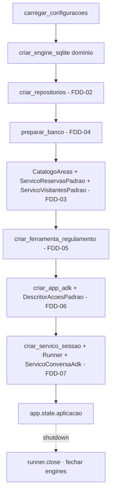

# Feature Design Document (FDD): API HTTP, rotas de verificação e montagem da aplicação

---
**Versão:** v1.0  
**Data:** 2026-10-30  
**Responsável:** Lucas Rocha  
**Status:** Rascunho  
**ADRs implementados:** [ADR-017](../adr/ADR-017-api-e-modelo-de-execucao.md), [ADR-016](../adr/ADR-016-ciclo-de-vida-dos-dados.md) (comando de subida e `preparar_banco` no `lifespan`)  
**Depende de:** [FDD-01](FDD-01-fundacao-e-contratos.md) (`ServicoConversa`, `ServicoReservas`, `ServicoVisitantes`, exceções de aplicação, `Configuracoes` e fakes)  
**Integra com, só na montagem (`aurora.api.montagem`):** FDD-02, FDD-03, FDD-04, FDD-05, FDD-06 e FDD-07. Este é o **único módulo** que importa implementações concretas de várias features (*composition root*).  
**Consumido por:** FDD-09 (roteiro de aceitação, como caixa-preta HTTP)  
---

## 1. Contexto e motivação técnica

A correção do desafio é feita **pelo contrato HTTP** do enunciado ([SUMMARY §7](../SUMMARY.md#7-contrato-da-api)): caminhos, campos e códigos `201`, `200`, `404` e `409`. O [ADR-017](../adr/ADR-017-api-e-modelo-de-execucao.md) decidiu por FastAPI e uvicorn em processo único, com os objetos caros criados uma vez no `lifespan` e um mapeamento explícito de erros.

Esta feature tem duas responsabilidades:

1. **A borda HTTP:** esquemas Pydantic de requisição e resposta, rotas finas e mapeamento de exceções para status. As rotas não contêm lógica; só traduzem HTTP para chamadas de `ServicoConversa`, `ServicoReservas` e `ServicoVisitantes` (*Separation of Concerns*: Handler → Service → Repository).
2. **A montagem** (`aurora.api.montagem`): instancia e liga as implementações reais de todas as features. Concentrar o *wiring* num único módulo mantém as demais features desacopladas entre si, como recomenda a skill `python-design-patterns` (*inject dependencies; composition over inheritance*).

As rotas de verificação leem **direto do domínio**, sem o modelo.

---

## 2. Objetivos técnicos

* Implementar as seis rotas do contrato com esquemas Pydantic fiéis aos campos do enunciado.
* Mapear de forma exaustiva as exceções de aplicação para status HTTP.
* Implementar `montar_aplicacao(configuracoes) -> Aplicacao` (a montagem) e o `lifespan`, que inclui `preparar_banco` (FDD-04) e o fechamento ordenado.
* Expor `uv run aurora-api`, servindo em `http://localhost:8000`.
* Testar as rotas com `httpx.AsyncClient` e fakes de `ServicoConversa` e dos serviços de domínio, sem ADK nem banco.

---

## 3. Escopo e exclusões

### Incluído
* `aurora/api/esquemas.py`: `CriarSessaoEntrada`, `CriarSessaoSaida`, `MensagemEntrada`, `ConfirmacaoEntrada`, `ConfirmacaoPendenteSaida`, `RespostaConversaSaida`, `ReservaSaida` e `VisitanteSaida`.
* `aurora/api/rotas_sessoes.py`: `POST /sessoes`, `POST /sessoes/{id}/mensagens`, `POST /sessoes/{id}/confirmacoes` e `GET /sessoes/{id}/eventos`.
* `aurora/api/rotas_verificacao.py`: `GET /apartamentos/{numero}/reservas` e `GET /apartamentos/{numero}/visitantes`.
* `aurora/api/erros.py`: os *exception handlers*.
* `aurora/api/montagem.py`: `Aplicacao` e `montar_aplicacao()`.
* `aurora/api/app.py`: `criar_app_http(aplicacao | fábrica) -> FastAPI` e o `lifespan`.
* `aurora/api/cli.py`: `main()` (`aurora-api`), com `uvicorn.run(..., host, porta, workers=1)`.

### Excluído
* Autenticação e autorização das rotas de verificação (fora de escopo no enunciado).
* A lógica de conversa e confirmação (FDD-07), as regras (FDD-03) e o SQL (FDD-02).
* O `README.md` final, que é tarefa de integração (ver o [índice](README.md#integração-final-fora-das-features)).

---

## 4. Fluxos detalhados e diagramas

* **Fluxo A: montagem e `lifespan`.**



* **Fluxo B: rota de confirmação.**
  1. Validar o corpo (`ConfirmacaoEntrada`: `id: str`, `confirmado: bool`); se for inválido, `422`.
  2. `resposta = await conversa.responder_confirmacao(session_id, corpo.id, corpo.confirmado)`.
  3. `SessaoNaoEncontrada` → `404`; `ConfirmacaoNaoPendente` → `409`; sucesso → `200` com `RespostaConversaSaida`.

* **Fluxo C: rotas de verificação.** `servico_reservas.listar_do_apartamento(numero)` é mapeado para `[{"codigo", "area", "data"}]`, e `servico_visitantes.listar_do_apartamento(numero)` para `[{"nome", "data"}]`. Nenhum modelo no caminho.

---

## 5. Contratos públicos (assinaturas, headers, exemplos)

### 5.1 Interface pública

```python
# src/aurora/api/__init__.py
__all__ = ["criar_app_http", "montar_aplicacao", "Aplicacao"]

@dataclass(slots=True)
class Aplicacao:
    conversa: ServicoConversa
    reservas: ServicoReservas
    visitantes: ServicoVisitantes
    fechar: Callable[[], Awaitable[None]]

async def montar_aplicacao(configuracoes: Configuracoes) -> Aplicacao: ...
def criar_app_http(montar: Callable[[], Awaitable[Aplicacao]]) -> FastAPI: ...  # testes injetam uma montagem com fakes
```

### 5.2 Semântica dos contratos de resposta

| Método e rota | Corpo | Sucesso | Erros |
| :--- | :--- | :--- | :--- |
| `POST /sessoes` | `{"apartamento": "101"}` | `201 {"session_id": "..."}` | `422` (corpo inválido ou apartamento inexistente) |
| `POST /sessoes/{session_id}/mensagens` | `{"texto": "..."}` | `200 {"resposta", "confirmacoes_pendentes": [...]}` | `404`, `422`, `503` |
| `POST /sessoes/{session_id}/confirmacoes` | `{"id": "...", "confirmado": bool}` | `200` (mesmo formato) | `404`, **`409`**, `422`, `503` |
| `GET /sessoes/{session_id}/eventos` | — | `200 [ {evento completo}, ... ]` | `404` |
| `GET /apartamentos/{numero}/reservas` | — | `200 [{"codigo", "area", "data"}]` | — |
| `GET /apartamentos/{numero}/visitantes` | — | `200 [{"nome", "data"}]` | — |

* Conflitos de negócio **nunca** geram `4xx` nem `5xx` nas rotas de conversa: viram `200` com a resposta do agente.
* Corpo de erro: `{"detail": "<mensagem genérica>"}`, sem dados internos.
* `confirmacoes_pendentes` é sempre uma lista (`[]` quando vazia); `resposta` é sempre uma string (pode ser `""`).

### 5.3 Exemplos de uso

```bash
curl -s -X POST localhost:8000/sessoes -H 'content-type: application/json' -d '{"apartamento":"101"}'
# {"session_id":"3f6c..."}
curl -s -X POST localhost:8000/sessoes/3f6c.../confirmacoes -H 'content-type: application/json' \
     -d '{"id":"id-inexistente","confirmado":true}' -o /dev/null -w '%{http_code}'
# 409
```

---

## 6. Configuração e opções

* **Requisitos de Runtime:** Python 3.12+; FastAPI e uvicorn (dependências do ADK).
* **Armazenamento / Dependências de Infra:** nenhuma direta; via montagem, os dois SQLite em `var/`.
* **Variáveis de ambiente e parâmetros:** `Configuracoes.host` (`127.0.0.1`) e `Configuracoes.porta` (`8000`), mais as do FDD-01.

```python
uvicorn.run("aurora.api.app:app", host=config.host, port=config.porta, workers=1, reload=False)
```

---

## 7. Erros, exceções e fallback

### 7.1 Concorrência e atomicidade
* **Por que é crítico:** no passo 14, duas aprovações chegam ao mesmo tempo em sessões diferentes, e as duas precisam de `200`.
* **Garantias:**
  - as rotas são `async` e não bloqueiam o loop;
  - a serialização acontece **por sessão** no FDD-07, e a exclusividade fica no banco (FDD-02);
  - com um único worker, os locks por sessão valem para todas as requisições.

### 7.2 Tratamento de erros gerais
| Situação de Erro | Tratamento Técnico / Comportamento |
| :--- | :--- |
| `SessaoNaoEncontrada` | `404 {"detail": "sessão não encontrada"}` |
| `ConfirmacaoNaoPendente` | `409 {"detail": "não existe confirmação pendente com esse id nesta sessão"}` |
| `ApartamentoInvalido` / `RequestValidationError` | `422` |
| `ModeloIndisponivel` | `503 {"detail": "assistente indisponível no momento"}` |
| `OperationalError` (banco travado) | `503` e log `ERROR` |
| Qualquer outra exceção | `500` genérico e log `ERROR` com *traceback* (sem expor detalhes no corpo) |

### 7.3 Modo permissivo (Fallback / Fail-Open)
* Não há. Se a montagem falhar (configuração inválida, regulamento malformado), a API **não sobe**, com mensagem clara no terminal.

---

## 8. Métricas, logs e tracing
* **Métricas:** fora de escopo.
* **Logs estruturados:** `configurar_logs()` (FDD-01) é chamado no `main()`. Um log de acesso por requisição traz método, rota, status e duração. Corpos de requisição não são logados.
* **Tracing:** não configurado.

---

## 9. Dependências e compatibilidade
| Componente | Versão mínima | Observações |
| :--- | :--- | :--- |
| FastAPI | ≥ 0.133 (via ADK) | `lifespan`, *exception handlers* |
| uvicorn | ≥ 0.34 (via ADK) | Um worker |
| **FDD-01** | — | `Protocol`s, DTOs, exceções e fakes (desenvolvimento das rotas) |
| **FDD-02 a FDD-07** | — | Importados **só** em `aurora/api/montagem.py`. A integração acontece quando cada um estiver pronto, um por vez, substituindo fakes |

---

## 10. Critérios de aceite técnicos
* [ ] Com fakes: todas as rotas devolvem os campos e status da tabela 5.2 (testes `httpx.AsyncClient`).
* [ ] `GET /sessoes/sessao-inexistente/eventos` → `404`; o mesmo vale para `/mensagens` e `/confirmacoes`.
* [ ] `confirmacoes_pendentes` serializa `id`, `acao` e `detalhes`, e `resposta` vazia é aceita.
* [ ] Num clone limpo, depois de `uv run aurora-restaurar`, `uv run aurora-api` responde em `http://localhost:8000` (integração).
* [ ] Reiniciar com Ctrl+C e subir de novo não altera reservas, visitantes nem eventos (integração com o FDD-04).
* [ ] `aurora.api.rotas_*` não importa nada de `aurora.persistencia`, `aurora.agentes` nem `aurora.conversa`; só `aurora.contratos`.

---

## 11. Riscos e mitigação
| Risco | Impacto | Mitigação |
| :--- | :--- | :--- |
| Divergência sutil do contrato (nome de campo, status) | Alto | Esquemas Pydantic como única saída; o FDD-09 verifica o contrato literalmente |
| A montagem virar ponto de acoplamento difícil de manter | Médio | Funções de fábrica pequenas por feature, cada uma com `__all__`; a montagem só chama fábricas, sem lógica |
| `localhost` resolver para IPv6 (`::1`) em algumas máquinas | Baixo | Testar `curl localhost:8000`; se necessário, servir em `0.0.0.0` ou `localhost` |
