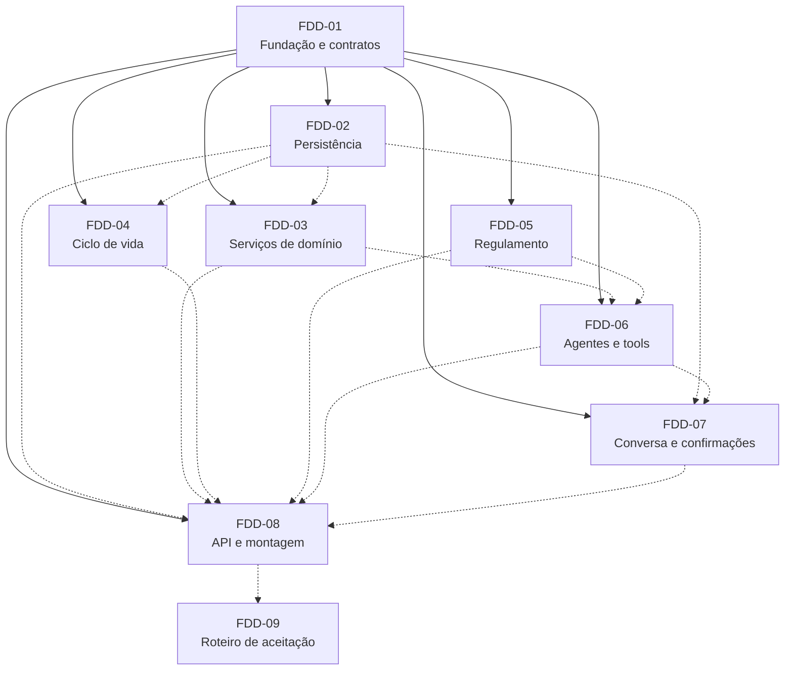

# Feature Design Documents — Assistente Virtual do Residencial Aurora

> **Base:** [`docs/adr/`](../adr/README.md) · [`docs/PRD.md`](../PRD.md) · [`docs/SUMMARY.md`](../SUMMARY.md)
> **Template:** [`docs/templates/FDD.md`](../templates/FDD.md)
> **Orientações aplicadas:** skills `python-design-patterns` (KISS, SRP, separação de camadas, injeção de dependência por construtor, composição) e `python-project-structure` (layout `src/`, um conceito por arquivo, `__all__` explícito, estrutura rasa, imports absolutos, testes em diretório paralelo)
> **Data:** 2026-10-30

Cada FDD descreve **uma feature isolada**, com escopo, contratos, critérios de aceite e riscos próprios. O isolamento vem de três regras:

1. **Contratos primeiro.** Todos os `Protocol`s e DTOs entre features ficam em `aurora.contratos` ([FDD-01](FDD-01-fundacao-e-contratos.md)), entregue antes de tudo (onda 0).
2. **Fakes para tudo.** O FDD-01 entrega implementações em memória de cada contrato, e cada feature testa sua camada com elas, sem esperar as outras.
3. **Um único ponto de montagem.** Implementações concretas de features diferentes só se encontram em `aurora/api/montagem.py` ([FDD-08](FDD-08-api-http-e-montagem.md)) e em `aurora/ciclo_de_vida/cli.py` ([FDD-04](FDD-04-ciclo-de-vida-dos-dados.md)).

As interdependências de cada feature estão no cabeçalho de cada documento (**Depende de**, **Integra com, só na montagem**, **Consumido por**) e na seção 9.

---

## Índice

| FDD | Feature | ADRs implementados | Depende de (código) | Integra na montagem |
| :--- | :--- | :--- | :--- | :--- |
| [FDD-01](FDD-01-fundacao-e-contratos.md) | Fundação do projeto e contratos compartilhados | 001, 002, 018 | — | — |
| [FDD-02](FDD-02-persistencia-do-dominio.md) | Persistência do domínio (esquema, repositórios, exclusividade, códigos) | 009, 012, 013, 014, 016 | FDD-01 | — |
| [FDD-03](FDD-03-servicos-de-dominio.md) | Serviços de domínio de reservas e visitantes | 001, 005, 010, 014 | FDD-01 | FDD-02 |
| [FDD-04](FDD-04-ciclo-de-vida-dos-dados.md) | Ciclo de vida dos dados (seed, inicialização, restauração) | 014, 016 | FDD-01 | FDD-02, FDD-07 (convenção do arquivo de sessões) |
| [FDD-05](FDD-05-consulta-ao-regulamento.md) | Consulta ao regulamento (índice e especialista isolado) | 003, 015 | FDD-01 | — |
| [FDD-06](FDD-06-agentes-e-ferramentas.md) | Agentes, tools de reservas e visitantes, `App` ADK | 003, 004, 005, 006, 009, 010, 018 | FDD-01 | FDD-03, FDD-05 |
| [FDD-07](FDD-07-conversa-e-confirmacoes.md) | Serviço de conversa, sessões persistentes e confirmações | 006, 007, 008, 009, 011, 017 | FDD-01 | FDD-02, FDD-06 |
| [FDD-08](FDD-08-api-http-e-montagem.md) | API HTTP, rotas de verificação e montagem | 016, 017 | FDD-01 | FDD-02 a FDD-07 |
| [FDD-09](FDD-09-roteiro-de-aceitacao.md) | Roteiro de aceitação automatizado (caixa-preta) | todos (validação) | contrato HTTP | executa sobre o FDD-08 integrado |

---

## Grafo de dependências entre features

Linha cheia: dependência de **código** (bloqueia o início). Linha tracejada: integração **na montagem** (não bloqueia o desenvolvimento, porque se usam fakes ou stubs até lá).



---

## Plano de execução em paralelo

| Onda | Features | Pode começar quando | Observação |
| :--- | :--- | :--- | :--- |
| **0** | FDD-01 | Imediatamente | Bloqueia as demais; deve ser curta (estrutura, contratos e fakes) |
| **1** (paralela) | FDD-02, FDD-03, FDD-04, FDD-05, FDD-06, FDD-07, FDD-08, FDD-09 | FDD-01 entregue | Cada uma desenvolve e testa contra os fakes do FDD-01 |
| **1a** (prioridade dentro da onda 1) | **FDD-07 + FDD-06**: PoC-1 a PoC-4 | FDD-01 entregue | O FDD-07 valida a confirmação com um agente de teste próprio; em seguida, repete com o `App` real do FDD-06. **Se falhar, aciona as contingências dos ADRs 002, 003 e 005 antes de o resto avançar** |
| **2** (integração) | FDD-08 liga as implementações reais na montagem, uma por vez | Cada feature com os critérios de aceite unitários cumpridos | Ordem sugerida: 02 → 03 → 04 → 05 → 06 → 07 |
| **3** (aceitação) | FDD-09 executado sobre o sistema integrado; PoC-5 e PoC-6 | Integração completa | Critério de pronto: o roteiro passa três vezes seguidas |

### Protocolo para mudança de contrato
Uma mudança em `aurora.contratos` durante a onda 1:

1. é proposta como alteração do [FDD-01](FDD-01-fundacao-e-contratos.md);
2. prefere adições compatíveis (parâmetros nomeados com padrão, novos tipos de resultado);
3. atualiza o fake correspondente no mesmo commit;
4. é comunicada às features consumidoras listadas no cabeçalho de cada FDD.

---

## Estrutura do código e propriedade dos arquivos

Layout `src/` raso, com um conceito por arquivo e testes em diretório paralelo (skill `python-project-structure`). **Cada caminho tem exatamente um dono**, o que evita conflitos entre trabalhos paralelos.

```text
.
├── pyproject.toml · uv.lock · .python-version · .env.example · .gitignore      FDD-01
├── src/aurora/
│   ├── __init__.py · config.py                                                  FDD-01
│   ├── contratos/   modelos.py · repositorios.py · servicos.py · conversa.py    FDD-01
│   ├── infra/       sqlite.py · modelo.py · logs.py                             FDD-01
│   ├── persistencia/ esquema.py · repositorio_reservas.py · repositorio_visitantes.py
│   │                 catalogo_referencia.py · indice_sessoes.py · carga_inicial.py   FDD-02
│   ├── dominio/     areas.py · validacao.py · codigos.py
│   │                servico_reservas.py · servico_visitantes.py                 FDD-03
│   ├── ciclo_de_vida/ dados_iniciais.py · inicializacao.py · restauracao.py · cli.py   FDD-04
│   ├── regulamento/ indice.py · ferramenta_capitulo.py · instrucoes.py · agente.py     FDD-05
│   ├── agentes/     identidade.py · serializacao.py · ferramentas_reservas.py
│   │                ferramentas_visitantes.py · instrucoes.py · topologia.py
│   │                descritor_acoes.py · app.py                                 FDD-06
│   ├── conversa/    sessoes.py · pendencias.py · resposta.py · eventos.py
│   │                travas.py · servico.py                                      FDD-07
│   └── api/         esquemas.py · rotas_sessoes.py · rotas_verificacao.py
│                    erros.py · montagem.py · app.py · cli.py                    FDD-08
└── tests/
    ├── fakes/                                                                   FDD-01
    ├── persistencia/ · dominio/ · ciclo_de_vida/ · regulamento/
    │   agentes/ · conversa/ · api/                                              FDD-02 a FDD-08 (cada um a sua pasta)
    └── aceitacao/                                                               FDD-09
```

**Regras de dependência entre pacotes** (verificadas por teste de import, conforme o FDD-01):

| Pacote | Pode importar de |
| :--- | :--- |
| `aurora.contratos` | só a biblioteca padrão |
| `aurora.infra` | `aurora.config` e bibliotecas externas |
| `aurora.dominio` | `aurora.contratos` |
| `aurora.persistencia` | `aurora.contratos`, `aurora.infra` |
| `aurora.ciclo_de_vida` | `aurora.contratos`, `aurora.config`; `cli.py` também `aurora.persistencia` e `aurora.infra` |
| `aurora.regulamento` | `aurora.contratos`, `aurora.config`, `aurora.infra`, `google.adk` |
| `aurora.agentes` | `aurora.contratos`, `aurora.config`, `aurora.infra`, `google.adk` |
| `aurora.conversa` | `aurora.contratos`, `aurora.config`, `aurora.infra`, `google.adk` |
| `aurora.api` (rotas) | `aurora.contratos` |
| `aurora.api.montagem` | todos (*composition root*) |

---

## Rastreabilidade ADR → FDD

| ADR | Decisão | FDD(s) |
| :--- | :--- | :--- |
| [ADR-001](../adr/ADR-001-regras-em-camada-de-dominio.md) | Regras no domínio, tools finas | 01 (contratos), 03 (regras), 06 (adaptadores) |
| [ADR-002](../adr/ADR-002-versao-do-google-adk.md) | ADK 2.13.0 fixado | 01 |
| [ADR-003](../adr/ADR-003-topologia-de-agentes.md) | Topologia de agentes | 05, 06 |
| [ADR-004](../adr/ADR-004-controle-de-turno-e-transferencias.md) | Bloqueios de transferência | 06 |
| [ADR-005](../adr/ADR-005-mecanismo-de-confirmacao.md) | `require_confirmation` declarativo | 03 (política), 06 (tools), 07 (resposta) |
| [ADR-006](../adr/ADR-006-retomada-sem-resumability.md) | `App` sem resumibilidade | 06, 07 |
| [ADR-007](../adr/ADR-007-fonte-de-verdade-das-confirmacoes.md) | Pendências derivadas dos eventos | 07 |
| [ADR-008](../adr/ADR-008-mensagens-com-confirmacao-pendente.md) | Mensagem com pendência aberta | 07 |
| [ADR-009](../adr/ADR-009-identidade-do-apartamento.md) | `user_id` = apartamento e índice de sessões | 02 (índice), 06 (tools), 07 (criação) |
| [ADR-010](../adr/ADR-010-minimizacao-de-dados-nas-tools.md) | Saídas mínimas | 01 (tipos), 03, 06 (serialização) |
| [ADR-011](../adr/ADR-011-servico-de-sessao-persistente.md) | Sessões em SQLite | 01 (engine), 07 |
| [ADR-012](../adr/ADR-012-armazenamento-do-dominio.md) | Domínio em SQLite | 01 (engine), 02 |
| [ADR-013](../adr/ADR-013-exclusividade-de-reserva.md) | Índice único parcial | 02 |
| [ADR-014](../adr/ADR-014-codigos-de-reserva.md) | Códigos e registro permanente | 02 (registro), 03 (gerador), 04 (preservação) |
| [ADR-015](../adr/ADR-015-consulta-ao-regulamento.md) | Regulamento por capítulo | 05 |
| [ADR-016](../adr/ADR-016-ciclo-de-vida-dos-dados.md) | Seed por marcador e restauração | 02 (SQL), 04 (política e CLI), 08 (`lifespan`) |
| [ADR-017](../adr/ADR-017-api-e-modelo-de-execucao.md) | FastAPI, processo único, lock por sessão | 07 (lock e composição), 08 (rotas e erros) |
| [ADR-018](../adr/ADR-018-modelos-gemini.md) | Modelo Flash por variável | 01 (fábrica), 06 (uso) |

### Garantias → FDD responsável pela prova
| Garantia | Onde a regra vive | Onde é provada |
| :--- | :--- | :--- |
| G1: cobrança ou acesso só com confirmação | FDD-03 (política), FDD-06 (`require_confirmation`), FDD-07 (`409`) | FDD-06 §10, FDD-07 PoC-1 a PoC-4, FDD-09 passos 6 a 9 e 11 |
| G2: cada sessão pertence a um apartamento | FDD-06 (`tool_context.user_id`), FDD-02 (filtro por apartamento), FDD-03 e FDD-06 (saídas mínimas) | FDD-02 §10, FDD-06 §10, FDD-09 passos 3, 4 e 10 |
| G3: nada se perde no reinício | FDD-07 (sessões), FDD-02 (domínio), FDD-04 (subida sem restaurar) | FDD-07 PoC-2, FDD-09 passo 13 |
| G4: regulamento consultado, não carregado | FDD-05 | FDD-05 §10, FDD-09 passo 12 |
| G5: dois moradores, uma reserva | FDD-02 (`ux_reserva_ativa`) | FDD-02 §10 (teste com 20 chamadas concorrentes), FDD-09 passo 14 |

---

## Integração final (fora das features)

Tarefas de fechamento, executadas depois da onda 3, sem FDD próprio por não terem desenho técnico:

* [ ] Escrever o `README.md` na raiz, com as seções **Arquitetura**, **Garantias** (apontando arquivos e trechos reais, conforme a tabela acima) e **Como rodar**.
* [ ] Decidir o destino do `ENUNCIADO.md` (o entregável pede que o README substitua o enunciado).
* [ ] Fixar o identificador do modelo Gemini padrão e registrá-lo no README ([ADR-018](../adr/ADR-018-modelos-gemini.md)).
* [ ] Atualizar o status dos ADRs que dependiam de PoC (de **Proposto** para **Aceito** ou **Substituído**).
* [ ] Ensaio final em clone limpo, seguindo apenas o README.
